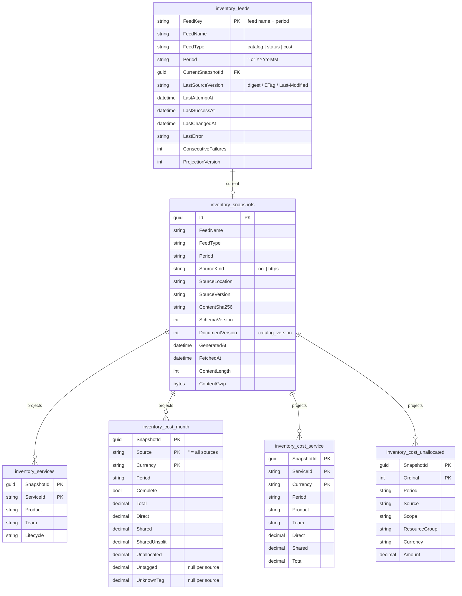

# Service inventory — implementation plan

> **Status:** views and storage approved 2026-11-20. This plan and ADR-0004 await approval; no
> production code exists yet. Phase 1 starts after that approval.

**Goal:** Show, for each service, who owns it, where it runs, which resources it has and what it
costs, read from JSON artifacts other systems publish (catalog, status, cost). The portal fetches,
caches and displays them; it never computes or edits them (ADR-0004).

**Architecture:** An `IArtifactSource` per kind of place (`oci`, `https`) answers "has it changed?"
and "give me the file". A background service refreshes each configured feed, stores every accepted
file compressed as a snapshot, projects it into a few query tables, and moves a per-feed pointer in
the same transaction. Pages and endpoints read through the pointer. The join to the portal's own
services is by name: catalog `id` = service name.

**Tech stack:** ASP.NET Core net10.0 Minimal API, EF Core with Postgres and SQL Server migration
sets, `IHttpClientFactory`, xUnit + NSubstitute; React 19 + TypeScript for Phase 2.

**Spec:** the task brief (summarised in ADR-0004 and below) and the prototype on branch
`claude/clever-cori-lri8fg-prototype` (README and screenshots under `docs/prototypes/service-inventory/`).

## Global constraints

- **Public repository.** Fixtures, recorded responses, examples, docs and tests use fictional names,
  hosts, IDs and amounts only (`registry.example.com`, `example-org`, `ledger-api`, …). No real
  registry, subscription, resource, organisation or cost data.
- No credentials in the repository, tests or logs. Credentials are referenced by name and resolved
  from configuration (the existing secret configuration), redacted with `SecretRedactor`.
- Name: **service inventory**. Never "catalog" for this feature (that is the request catalog) and never
  "registry" for it (that is the build registry; "registry" means only the OCI registry here).
  Code: `Features/ServiceInventory`; API: `/api/service-inventory/...`; UI: `/inventory/...`; flag:
  `features.serviceInventory`; tables: `inventory_*`.
- Portable SQL only: no JSON functions in queries, no provider-specific DDL; `""` instead of NULL in
  unique keys (ADR-0003). Every change ships a Postgres and a SQL Server migration.
- Unknown JSON fields are ignored. A new field never changes `schemaVersion`. A file whose
  `schemaVersion` is not supported is rejected whole.
- Amounts: one row per currency, never added across currencies. Direct and shared cost stay separate.
- "Unknown" and "unresolved" mean not observed; never mapped to failed or absent.
- Feature flag off by default. Phase 1 has nothing user-visible, so no "What's new" entry.

## Decisions (2026-11-20)

| # | Question | Answer |
|---|---|---|
| 1 | Service identity | The catalog `id` is the service name. |
| 2 | Can the portal's environment reach the registry over 443? | Yes. |
| 3 | Who sees cost? | Everyone signed in. The feed status panel is admin-only. |
| 4 | Catalog environment keys (`dev`, `test`, `stage`, `prod`, `sandbox`, `nonprod`) | Mapped through the portal's existing environment aliases. |
| 5 | Product on the cost page | The catalog's product and team. Deploys will be brought in line with the catalog. |
| 6 | Sorting across currencies | By the period's largest currency, others shown beside it. |
| 7 | Retention | As under "History kept". |
| 8 | Narrow screens | Tables scroll sideways inside their card. |

## Review focus

1. A failed fetch, a non-JSON body, an oversize body, a blocked host or an unsupported
   `schemaVersion` must leave `CurrentSnapshotId` and all projected rows untouched, and record the
   reason. → Task 9 tests.
2. Credentials must never reach a host other than the one configured for them: not the blob redirect
   target, not a redirect off the allowlist. → Tasks 3 and 5 tests.
3. A page never reads a mix of two snapshots: the snapshot, its rows and the pointer move in one
   transaction. → Task 9 test (interrupted projection rolls back).
4. No query adds amounts of different currencies. → Task 8 projector tests, Task 11 endpoint tests.
5. Unchanged content does not download (OCI digest, `ETag`, `Last-Modified`) and does not create a
   snapshot (same SHA-256). → Tasks 4, 5, 9 tests.

---

## Name and glossary

Added to `GLOSSARY.md` with this plan:

> **Service Inventory**: The portal's read-only copy of the services, teams, products and shared
> resources published by the service catalog, with their observed state and attributed cost.
> Rebuilt at any time from the published artifacts; never edited in the portal.
> _Avoid_: Service catalog (the request catalog's former name), service registry, CMDB

## Configuration

```jsonc
"ServiceInventory": {
  // Every host the inventory may call. HTTPS only. An entry is a host (port 443) or host:port.
  // A redirect to a host not listed is refused, except the OCI blob redirect (no credentials,
  // content checked against its digest, public addresses only — list private storage here).
  "AllowedHosts": ["registry.example.com", "files.example.com"],
  "MaxResponseBytes": 20971520,      // 20 MiB per response
  "TimeoutSeconds": 30,
  // Named credentials. Values come from the secret configuration (environment, key vault…), never
  // from this file. Kinds: none | bearer | basic | header | query.
  "Credentials": {
    "registry": { "Kind": "basic", "Username": "", "Password": "" },
    "files-sas": { "Kind": "query", "Value": "" }           // appended to the URL, never logged or stored
  },
  "Feeds": [
    { "Name": "catalog", "Type": "catalog", "Credential": "registry", "PollMinutes": 15,
      "Source": { "Kind": "oci", "Registry": "registry.example.com",
                  "Repository": "service-catalog/catalog", "Tag": "latest", "File": "catalog.json" } },
    { "Name": "status", "Type": "status", "Credential": "registry", "PollMinutes": 10,
      "Source": { "Kind": "oci", "Registry": "registry.example.com",
                  "Repository": "service-catalog/status", "Tag": "latest", "File": "status.json" } },
    { "Name": "cost", "Type": "cost", "Credential": "registry", "PollMinutes": 60,
      "Source": { "Kind": "oci", "Registry": "registry.example.com",
                  "Repository": "service-cost/allocation", "Tag": "latest", "File": "cost.json",
                  "ClosedMonths": { "From": "2026-11" } } }   // tags matching YYYY-MM, from this month on
    // The same feed from plain HTTPS:
    // { "Name": "cost", "Type": "cost", "Credential": "files-sas", "PollMinutes": 60,
    //   "Source": { "Kind": "https", "Url": "https://files.example.com/cost/latest.json",
    //               "ClosedMonths": { "From": "2026-11",
    //                                 "UrlTemplate": "https://files.example.com/cost/{month}.json" } } }
  ]
}
```

Checked by the refresh service and shown in `GET /feeds` (not `ValidateOnStart`, so the rest of the portal always starts): unique feed names; at most one feed per type; every source
host in `AllowedHosts`; `https` scheme; no user name or password in a URL; every `Credential` names a
configured entry; a `query` credential only on an `https` source.

An `oci` source sends its credential to the registry host only. A registry whose token service is
on another host (its challenge's `realm`) needs that host named as the source's `AuthHost` (and on
the allowlist); a challenge naming any other host is refused, even one allowlisted for another feed. An invalid configuration logs which feed and why and disables
the inventory; the rest of the portal starts normally.

## Storage (approved)

### Principles

- The raw JSON of every accepted fetch is the source of truth inside the portal. Every other
  inventory table is a projection of one raw snapshot and can be thrown away and rebuilt from it.
- A page reads exactly one snapshot per feed, chosen through a pointer that moves in the same
  transaction that writes the snapshot and its projection. No page ever sees half a refresh.
- Portable across both engines: no JSON functions in SQL, no provider-specific DDL. Projection is C#.

### Tables



| Table | Column types (Postgres / SQL Server) | Keys and indexes |
|---|---|---|
| `inventory_feeds` | text `varchar(n)` / `nvarchar(n)`; times `timestamptz` / `datetimeoffset`; `LastError varchar(1000)` (redacted) | PK `FeedKey` (`{FeedName}` or `{FeedName}:{Period}`); unique `(FeedName, Period)` |
| `inventory_snapshots` | `ContentGzip bytea` / `varbinary(max)`; `ContentSha256 char(71)` (`sha256:` + hex); `SourceLocation varchar(500)` without query string | PK `Id`; unique `(FeedName, Period, ContentSha256)`; index `(FeedName, Period, FetchedAt desc)` |
| `inventory_services` | `ServiceId varchar(63)` | PK `(SnapshotId, ServiceId)`; index `(SnapshotId, Product)`, `(SnapshotId, Team)` |
| `inventory_cost_month` | amounts `numeric(19,4)` / `decimal(19,4)`; `Currency char(3)` | PK `(SnapshotId, Source, Currency)`; index `(Period)` |
| `inventory_cost_service` | as above | PK `(SnapshotId, ServiceId, Currency)`; index `(SnapshotId, Product)`, `(SnapshotId, Team)` |
| `inventory_cost_unallocated` | as above; `Scope varchar(200)`, `ResourceGroup varchar(200)` (`""` when absent) | PK `(SnapshotId, Ordinal)`; index `(SnapshotId, Currency, Amount desc)` |

Snapshots are gzip-compressed: the files are repetitive JSON, compress well, and are only ever read
whole (projection, rebuild, an admin download). The SHA-256 is of the uncompressed body. A SAS token
or other query-string credential is never part of `SourceLocation`.

### What reads what

| Need | Read from |
|---|---|
| Service section: catalog entry, team, environments, bindings, workloads | current catalog snapshot, parsed once per snapshot id and cached in memory |
| Service section: observed bindings, shared state, onboarding, warnings | current status snapshot, parsed and cached the same way |
| Service section: cost of the month, resource lines | `inventory_cost_service` for totals; resource lines from the cost snapshot |
| Which catalog ids exist, by product or team (join, cost lists) | `inventory_services` |
| Cost page: totals, services by cost, trend | `inventory_cost_service` over the current snapshot of every period |
| Coverage page | `inventory_cost_month` + `inventory_cost_unallocated` |
| Data age, failures | `inventory_feeds` |

**Rebuild.** `InventoryProjector.Project(snapshot)` is a pure function from one raw snapshot to its
rows. `inventory_feeds.ProjectionVersion` records the projector version that built the current rows;
on startup every current snapshot with an older version is re-projected from its raw copy, and an
admin endpoint does the same on demand.

### How a refresh replaces data

1. Ask the source whether it changed (manifest digest / `ETag` / `Last-Modified` against
   `LastSourceVersion`). Unchanged: update `LastAttemptAt`, `LastSuccessAt`; stop.
2. Download (size limit, timeout, JSON content type) and hash the body. Same SHA-256 as the current
   snapshot: record the new `LastSourceVersion`; stop.
3. Parse and check `schemaVersion`. Unsupported or invalid: write `LastError`, keep the pointer.
4. One transaction: insert the snapshot, insert its projected rows (keyed by the new snapshot id),
   move `CurrentSnapshotId`, set `LastChangedAt`/`LastSuccessAt`, clear `LastError`.
5. Rows of the previous snapshot are deleted by the retention job, not by the refresh.

### History kept

| Feed | Fetched | Raw snapshots kept | Projected rows kept |
|---|---|---|---|
| catalog | on change (polled every 15 min) | every version, forever | current only |
| status | every 30 min, always new | all for 7 days; then the last of each day for 90 days; then none | current only |
| cost, current month (`latest`) | daily | every daily snapshot for 90 days | current only |
| cost, closed month (`YYYY-MM`) | once, when it first appears | forever | forever (one per period) |

When a closed month appears, its snapshot becomes that period's current one; the month's daily
snapshots stay as raw history until they age out.

### Amounts and currencies

One row per currency; no column adds currencies. Each period gets a row for every currency in that
period's `totals.total`, also when a service's amount is zero (an empty object in the file), so
"services by cost" lists every service. Sorting uses the period's largest currency. `decimal(19,4)`;
amounts are stored as published.

### Size after one year

Assume 500 services within a year: catalog ~750 KB, status ~870 KB, cost ~850 KB per file;
compression 8:1.

| Item | Arithmetic | Raw | Stored |
|---|---|---|---|
| catalog versions | ~5 a week → 260 × 750 KB | 195 MB | ~25 MB |
| status | (7 × 48 + 90) = 426 × 870 KB | 370 MB | ~46 MB |
| cost, daily | 90 × 850 KB | 77 MB | ~10 MB |
| cost, closed months | 12 × 850 KB | 10 MB | ~1.3 MB |
| `inventory_cost_service` | 13 periods × 500 × 2 currencies × ~150 B | | ~2 MB |
| `inventory_cost_unallocated` | 13 × ~500 rows × ~200 B | | ~1.3 MB |
| other tables | < 1,000 rows | | < 0.2 MB |
| **Total** | | | **~85 MB** |

### Example rows (fictional)

`inventory_feeds`

| FeedKey | FeedType | Period | CurrentSnapshotId | LastSourceVersion | LastSuccessAt | LastError |
|---|---|---|---|---|---|---|
| `catalog` | catalog | | `9a1…` | `sha256:<manifest digest>` | 2026-11-20 15:37 | |
| `status` | status | | `4c7…` | `sha256:<manifest digest>` | 2026-11-20 15:30 | |
| `cost:2026-11` | cost | 2026-11 | `e02…` | `sha256:<manifest digest>` | 2026-11-20 15:26 | |

`inventory_snapshots` (content columns omitted)

| Id | FeedName | Period | SourceKind | SourceLocation | SchemaVersion | DocumentVersion | GeneratedAt |
|---|---|---|---|---|---|---|---|
| `9a1…` | catalog | | oci | `registry.example.com/service-catalog/catalog:latest` | 1 | 5 | |
| `4c7…` | status | | oci | `registry.example.com/service-catalog/status:latest` | 1 | 5 | 2026-11-20 13:28:32 |
| `e02…` | cost | 2026-11 | oci | `registry.example.com/service-cost/allocation:latest` | 2 | 5 | 2026-11-20 15:24:57 |

`inventory_services`

| SnapshotId | ServiceId | Product | Team | Lifecycle |
|---|---|---|---|---|
| `9a1…` | ledger-api | payments | platform-team | production |
| `9a1…` | order-router | storefront | storefront-team | planned |

`inventory_cost_month`

| SnapshotId | Source | Currency | Period | Complete | Total | Direct | Shared | SharedUnsplit | Unallocated | Untagged | UnknownTag |
|---|---|---|---|---|---|---|---|---|---|---|---|
| `e02…` | | USD | 2026-11 | false | 9876.40 | 0 | 0 | 0 | 9876.40 | 9876.40 | 0 |
| `e02…` | azure | USD | 2026-11 | false | 9876.40 | 0 | 0 | 0 | 9876.40 | null | null |

(The file splits `unallocated` into untagged and unknown tag only for all sources together, so
per-source rows leave those two null rather than inventing a split.)

`inventory_cost_service`

| SnapshotId | ServiceId | Currency | Period | Product | Team | Direct | Shared | Total |
|---|---|---|---|---|---|---|---|---|
| `e02…` | ledger-api | USD | 2026-11 | payments | platform-team | 0 | 0 | 0 |
| `e02…` | order-router | USD | 2026-11 | storefront | storefront-team | 0 | 0 | 0 |

`inventory_cost_unallocated`

| SnapshotId | Ordinal | Period | Source | Scope | ResourceGroup | Currency | Amount |
|---|---|---|---|---|---|---|---|
| `e02…` | 0 | 2026-11 | azure | 11111111-2222-4333-8444-555555555555 | aks-prod-nodes | USD | 2310.25 |
| `e02…` | 1 | 2026-11 | azure | 11111111-2222-4333-8444-555555555555 | analytics-db-rg | USD | 1254.00 |
| `e02…` | 2 | 2026-11 | azure | 11111111-2222-4333-8444-555555555555 | legacy-vms-rg | USD | 866.90 |

### Query behind each view

```sql
-- cur := SELECT Period, CurrentSnapshotId FROM inventory_feeds WHERE FeedType = 'cost'

-- Service section: the month's cost of one service
SELECT Currency, Direct, Shared, Total
FROM inventory_cost_service s JOIN cur ON cur.CurrentSnapshotId = s.SnapshotId
WHERE cur.Period = @currentPeriod AND s.ServiceId = @serviceId;

-- Service section: the join
SELECT s.* FROM inventory_services s
JOIN inventory_feeds f ON f.CurrentSnapshotId = s.SnapshotId AND f.FeedType = 'catalog'
WHERE s.ServiceId = LOWER(@serviceName);

-- Cost page: totals of a product (team: same with Team)
SELECT Currency, SUM(Direct), SUM(Shared), SUM(Total)
FROM inventory_cost_service s JOIN cur ON cur.CurrentSnapshotId = s.SnapshotId
WHERE cur.Period = @period AND s.Product = @product GROUP BY Currency;

-- Cost page: services by cost (sorted in C# by the period's largest currency)
SELECT ServiceId, Team, Currency, Direct, Shared, Total
FROM inventory_cost_service s JOIN cur ON cur.CurrentSnapshotId = s.SnapshotId
WHERE cur.Period = @period AND s.Product = @product;

-- Cost page: monthly trend
SELECT cur.Period, m.Complete, s.Currency, SUM(s.Direct), SUM(s.Shared)
FROM inventory_cost_service s
JOIN cur ON cur.CurrentSnapshotId = s.SnapshotId
JOIN inventory_cost_month m ON m.SnapshotId = s.SnapshotId AND m.Source = '' AND m.Currency = s.Currency
WHERE s.Product = @product GROUP BY cur.Period, m.Complete, s.Currency ORDER BY cur.Period;

-- Coverage: the month's parts, all sources and per source
SELECT * FROM inventory_cost_month m JOIN cur ON cur.CurrentSnapshotId = m.SnapshotId
WHERE cur.Period = @period;

-- Coverage: largest unattributed (by subscription: GROUP BY Source, Scope)
SELECT Source, Scope, ResourceGroup, Amount
FROM inventory_cost_unallocated u JOIN cur ON cur.CurrentSnapshotId = u.SnapshotId
WHERE cur.Period = @period AND Currency = @currency ORDER BY Amount DESC;  -- Take(10)

-- Coverage over time
SELECT cur.Period, m.Complete, m.Currency, m.Total, m.Direct + m.Shared AS Attributed
FROM inventory_cost_month m JOIN cur ON cur.CurrentSnapshotId = m.SnapshotId
WHERE m.Source = '' ORDER BY cur.Period;

-- Data age
SELECT FeedName, Period, LastSuccessAt, LastAttemptAt, LastError FROM inventory_feeds;
```

## Service identity

A portal service matches the catalog entry whose `id` equals its service name, compared
case-insensitively. The product is not part of the match; when the portal's product differs from the
catalog's, the service section says so. A name reported under more than one product matches the same
entry on each product's page. Computed at read time, not stored.
`scripts/service-inventory-identity-check.py` reports mismatches against a running portal.

---

## Phase 1 tasks

All new code under `src/Platform.Api/Features/ServiceInventory/` unless stated. Tests under
`tests/Platform.Api.Tests/Features/ServiceInventory/` (unit) and `tests/Platform.Integration.Tests/`
(endpoints, migrations). Fixtures under `tests/Platform.Api.Tests/Features/ServiceInventory/Fixtures/`:
`catalog.json`, `status.json`, `cost-2026-11.json` (fictional files with the published shape, the same
as the prototype's), `cost-v1.json` (an old-format file), and recorded registry and HTTPS exchanges
(token challenge, token, manifest, tag list, blob redirect, `ETag` / `Last-Modified` responses), all
fictional.

### Task 1: Docs (this PR)

ADR-0004, this plan, the `GLOSSARY.md` entry.

### Task 2: Options, flag, wiring

**Files:** `ServiceInventoryOptions.cs` (+ validator), `Infrastructure/Features/IFeatureFlags.cs`
(`FeatureFlagKeys.ServiceInventory = "features.serviceInventory"`), `FeatureFlagSeeder.cs` (default
`false`, config path `Features:ServiceInventory:DefaultEnabled`), `Program.cs`, `appsettings.json`
(empty `ServiceInventory` section with a `_comment`), `featureFlagsStore.ts` (key only).

Tests: validation rejects a host not in `AllowedHosts`, `http://`, an unknown credential, two catalog
feeds, a `query` credential on an `oci` source; a valid configuration binds.

### Task 3: Guarded outbound HTTP (TDD)

**Files:** `Http/InventoryHttpClient.cs`, `Http/InventoryHttpException.cs`.

One named `HttpClient` with `AllowAutoRedirect = false` and its default request logging removed
(URLs may carry a SAS token), wrapped so that it:
- refuses anything but `https`, and hosts not in `AllowedHosts`, before connecting;
- follows redirects itself, at most 3, re-checking each target; credentials are attached per request
  only when the request host is the credential's own host;
- reads at most `MaxResponseBytes` (checks `Content-Length`, then counts while streaming);
- applies `TimeoutSeconds` per request;
- requires a JSON content type for documents (`application/json` or `+json`; OCI blobs may be
  `application/octet-stream`, since their type comes from the manifest);
- builds error messages from status code, host and path only, passed through `SecretRedactor`.

Tests: blocked host; `http` scheme; redirect off the allowlist refused; redirect within it followed;
oversize by header and by stream; timeout; HTML content type refused; the `Authorization` header is
never sent to a different host; error text contains no query string.

### Task 4: `IArtifactSource` and the HTTPS source (TDD)

**Files:** `Sources/IArtifactSource.cs`, `Sources/HttpsArtifactSource.cs`, `Sources/ArtifactSourceFactory.cs`.

```csharp
public interface IArtifactSource
{
    /// Cheap check. A null version means unknown: the caller downloads and compares hashes.
    Task<ChangeCheck> CheckAsync(string? lastVersion, CancellationToken ct);
    Task<ArtifactFile> FetchAsync(CancellationToken ct);                       // bytes + version + location
    Task<IReadOnlyList<string>> ListClosedMonthsAsync(CancellationToken ct);   // YYYY-MM
    IArtifactSource ForMonth(string period);                                   // the closed-month artifact
}
```

HTTPS: conditional `GET` with `If-None-Match` (stored `ETag`) or `If-Modified-Since` (stored
`Last-Modified`); `304` means unchanged. When the server sends neither header, the version is the
body's SHA-256 (download, compare). Closed months: `UrlTemplate` with `{month}`, probing each month
from `From` up to the previous month that is not stored yet; `404` means not published yet.

Tests (recorded responses): `ETag` round trip with `304`; `Last-Modified` fallback; no validators →
hash; a query credential appended to the request but absent from `ArtifactFile.Location` and from
errors; month probing stops at `404` and skips stored months.

### Task 5: The OCI source (TDD)

**Files:** `Sources/OciArtifactSource.cs`, `Sources/OciChallenge.cs`.

1. `HEAD /v2/{repo}/manifests/{tag}` with `Accept: application/vnd.oci.image.manifest.v1+json`.
   On `401`, parse `WWW-Authenticate: Bearer realm=…,service=…`; the realm host must be in
   `AllowedHosts`; `GET {realm}?service=…&scope=repository:{repo}:pull` with the feed's credential;
   take `access_token` (or `token`); reuse it until shortly before `expires_in`.
2. The `Docker-Content-Digest` of the `HEAD` is the version. Equal to the stored one → unchanged.
3. Changed: `GET` the manifest and pick the layer whose
   `annotations["org.opencontainers.image.title"]` equals `File`; other layers (for example an HTML
   report) are ignored; no such layer → error.
4. `GET /v2/{repo}/blobs/{digest}` with the bearer token. A redirect to another host is followed once,
   HTTPS only, **without** `Authorization`, even if that host is not in `AllowedHosts`; the body's
   SHA-256 must equal the layer digest, or the file is rejected.
5. Closed months: `GET /v2/{repo}/tags/list` (following `Link` pagination), keeping tags that match
   `^\d{4}-\d{2}$` at or after `From`.

Tests: challenge → token → manifest → blob happy path; unchanged digest makes no `GET`; blob redirect
followed without `Authorization`; digest mismatch rejected; missing layer; realm off the allowlist
refused; token reused while valid; tag list filtered and paginated.

### Task 6: Documents and format versions (TDD)

**Files:** `Documents/CatalogDocument.cs`, `StatusDocument.cs`, `CostDocument.cs`, `DocumentReader.cs`.

Typed records with only the fields the portal uses; `System.Text.Json` ignoring unknown members;
money as `Dictionary<string, decimal>` with keys checked against `^[A-Z]{3}$`. Supported versions:
catalog 1, status 1, cost 2. The reader returns a document or a rejection reason
(`unsupported schemaVersion 3`, `not valid JSON`, `missing period`), never a partial document.

Tests: the three fixtures parse; an added unknown field still parses; `cost-v1.json` is rejected as
unsupported; an invalid currency key is rejected; `period` must match `YYYY-MM`.

### Task 7: Entities, DbContext, migrations

**Files:** `Models/Inventory*.cs`, `Infrastructure/Persistence/PlatformDbContext.cs`, migrations
`AddServiceInventory` in `Migrations/Postgres` and `Migrations/SqlServer`
(`dotnet ef migrations add AddServiceInventory --context PostgresPlatformDbContext --output-dir Migrations/Postgres`,
and the same with `SqlServerPlatformDbContext` and `Migrations/SqlServer`). Tables, keys and indexes
exactly as under "Storage".

Tests: both migration sets apply; a snapshot with gzip content round-trips.

### Task 8: Projector and rebuild (TDD)

**Files:** `InventoryProjector.cs`, `InventoryDocumentCache.cs`.

Pure projection per feed type with a `ProjectionVersion` constant; the parsed catalog and status are
cached in memory by snapshot id. Rebuild on startup for current snapshots with an older projection
version, and on demand through `POST /api/service-inventory/rebuild` (admin).

Tests: the cost fixture gives the expected rows (one per service per period currency, zeros
included; the all-sources row carries untagged and unknown tag, per-source rows carry null); two
currencies stay two rows; projecting the same snapshot twice gives identical rows; rebuilding after
the rows were dropped restores them.

### Task 9: Refresh (TDD)

**Files:** `InventoryRefresher.cs`.

The algorithm under "How a refresh replaces data", for one feed, and for cost also each closed month
not yet stored. A stored closed month is never fetched again.

Tests: unchanged source → no download, no snapshot, `LastSuccessAt` moves; changed version with the
same body → no snapshot; new body → snapshot, rows and pointer committed together; a failure during
projection → nothing committed, pointer unchanged; fetch failure, blocked host, oversize body and
unsupported `schemaVersion` → previous copy kept, `LastError` set and redacted,
`ConsecutiveFailures` incremented; a later success clears them.

### Task 10: Background service and retention

**Files:** `BackgroundServices/ServiceInventorySyncService.cs`, `InventoryRetention.cs`.

Same shape as `CatalogSyncService`: a loop with a scope per cycle; each feed refreshed when its
`PollMinutes` have elapsed; one feed's failure never stops the others; does nothing while the flag is
off or the configuration is invalid. Retention runs once a day, keeps snapshots per "History kept"
and deletes the projected rows of snapshots that are no longer current.

Tests: only due feeds refresh; a throwing feed does not stop the next; flag off → no outbound call;
retention keeps the right snapshots for a synthetic week of status files.

### Task 11: Read-only endpoints

**Files:** `ServiceInventoryEndpoints.cs`, `notes/service-inventory-api.md`.

Under `/api/service-inventory`, for signed-in users, flag-gated like the other features:

| Endpoint | Returns |
|---|---|
| `GET /services/{serviceName}` | The catalog entry matched by name: team, product, lifecycle, environments, bindings, workloads; whether the portal's product differs; data age. `404` when there is no entry. |
| `GET /services/{serviceName}/observed` | Observed bindings per environment and database, the shared resources it uses with their state, tagged resources, onboarding, warnings; data age. |
| `GET /services/{serviceName}/cost?period=YYYY-MM` | Direct, shared and total per currency, resource lines, shared-from, `complete`; the current period by default. |
| `GET /feeds` (admin) | Per feed: type, source kind, location without credentials or query string, stored version, `LastSuccessAt`, `LastAttemptAt`, `LastError`. |
| `POST /rebuild` (admin) | Re-projects the current snapshots. |

No endpoint returns credentials, and only admins can reach anything beyond the projected data.

Tests: each endpoint against seeded snapshots; flag off → refused; unknown service → `404`; `/feeds`
requires admin and hides query strings; two currencies come back as two entries.

### Task 12: Verify

`dotnet test` for both test projects; `npx tsc -b` in `src/Platform.Web`; both migration sets applied
to fresh databases; a manual run against a local HTTPS file server serving the fictional fixtures.

## Phase 2 (after Phase 1 is merged)

The prototype's views built on the stored data, behind the flag: the service section on the service
page, `/inventory/cost`, `/inventory/coverage` and the admin feed panel, with the product, team and
coverage endpoints they need (queries above); and a "What's new" entry in the PR that turns the flag on.
