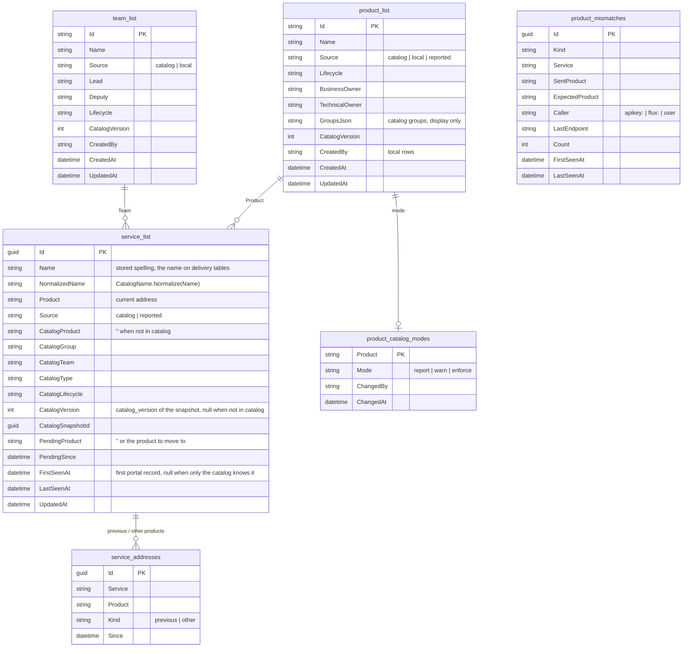

# Service list and catalog product — implementation plan

> **Status:** draft for review, 2026-11-22. Stage 1 of the "deployments and releases" brief: logic
> L-1..L-10, API P-1..P-6, screens E-1..E-7, decisions D-1..D-7 and D-24. Governed by
> `docs/adr/0005-the-catalog-is-the-source-of-a-services-product.md` (ADR 0005) and
> `docs/adr/0006-changing-a-services-product-moves-its-data.md` (ADR 0006).

**Goal:** Give the portal one stored list of services, products and teams, copied from the service
catalog, and let the catalog decide a service's product. Every product picker and every "services
of a product" list reads that list. When a service's product changes, an admin moves its data after
a preview, old addresses keep working, and every event remembers the product it happened under.

**Architecture:** A `service_list` table holds one row per service name with its current product
(the address its data lives under) and what the catalog says about it. It is rebuilt from the
portal's own records plus the current catalog snapshot of the service inventory, and refreshed each
time that snapshot changes. `ServiceProductOverrideService.ResolveAsync`, the one place every write
path already asks for a service's product, also consults the list and the product's catalog mode
(report → warn → enforce). `ServiceProductRemapService` grows into the single move path for an
admin's override and a catalog change.

**Tech stack:** ASP.NET Core net10.0 Minimal API, EF Core with Postgres and SQL Server migration
sets, xUnit + NSubstitute; React 19 + TypeScript.

**Spec:** the task brief (decisions D-1..D-27, numbering L/P/E is final), ADR 0005, ADR 0006.
Assumes the service inventory (`docs/plans/service-inventory.md`) is deployed and enabled.

**Not in this stage** (other plans):

- Release trains, releases from a train, ad hoc releases, completion record, train freeze, approval
  policies for selected services, the shared policy-resolution point, webhook service patterns, the
  one-off move of extension and support-tool services into `mkp` → `docs/plans/release-trains.md`.
- Release notes for a release, analytics by train, team and product-at-the-time →
  `docs/plans/release-notes-for-a-release.md`.
- Navigation and My Tasks → `docs/plans/navigation.md`.
- The **train** column of E-1 and E-5 is added by the release-trains plan; stage 1 leaves room for it.
- Service groups are read from the catalog when it publishes them and are display-only here. Stage 1
  stores them — `service_list.CatalogGroup` per service, `product_list.GroupsJson` per product — and
  nothing in stage 1 decides by them. Stage 2 builds on exactly these two columns (the "effective
  group", the `service_group_changes` table and a hook in `ServiceListCatalogSync.ApplyAsync`, all in
  `docs/plans/release-trains.md`); they are not part of this stage.

## Global constraints

- **Derived cache, never a second owner.** Catalog-sourced fields are overwritten by the next refresh
  and are never editable in the portal. A wrong product, team or group is fixed in the catalog.
  Dropping every catalog-sourced and reported row and rebuilding gives the same list (ADR 0005).
- **`product` stays required** in deploy, build, promotion and migration requests, in every mode
  (D-4). The portal resolves the product on its own side.
- **No rejection without a warning period.** Nothing that passes through the API today may start
  being rejected. Each new refusal in this plan (name collision, enforce precondition) is first
  recorded as a mismatch for at least one step before it can refuse.
- **Names** follow `^[a-z0-9]([a-z0-9-]{0,61}[a-z0-9])?$` (D-24). The portal normalises on write:
  trim, lower-case, `.` and `_` → `-`. It does not reject; the response carries a warning. A write
  whose normalised name would collide with a *different* existing name is refused. One function,
  `CatalogName.Normalize`, is used by the write paths, the inventory projector and the scope checks.
- **Local and fallback entries never leave the portal.** A local product, a local team, the label
  "not in catalog" and the product `default` are never written to tags, never sent in webhook
  payloads as anything but the product string the service is stored under, and are left out of the
  export for the catalog.
- The portal shows catalog readiness; it **never gates a promotion on it** (D-19).
- Name: **service list**. Never "service registry" (`GLOSSARY.md` lists it under _Avoid_; "registry"
  means the build registry or the OCI registry). Code: `Features/ServiceList`; API: `/api/services`,
  `/api/products`, `/api/teams`, `/api/service-list/...`; UI: `/settings/services`; flag:
  `features.serviceList`; tables: `service_list`, `service_addresses`, `product_list`, `team_list`,
  `product_catalog_modes`, `product_mismatches`.
- Portable SQL only: no JSON functions in queries, no provider-specific DDL, `""` instead of NULL in
  unique keys (ADR-0003). Every schema change ships a Postgres and a SQL Server migration
  (`Migrations/Postgres`, `Migrations/SqlServer`).
- Public repository: fixtures, examples and tests use the placeholder vocabulary only (`mkp`,
  `mkp-extensions`, `mkp-support-tools`, `mkp-extension-adobe`, `acx-extension-mscsp`,
  `mkp-spotlight`, `mkp-release`, `ops-release`, org `acmetrix`).
- Each rollout step (1a → 1b → 1c → 1d) ships on its own and can be switched back. Behaviour a
  pipeline can observe changes only in 1d.

## Decisions (from the brief)

| # | Decision | Where it lands |
|---|---|---|
| D-1 | Products, teams and groups come from the catalog; an admin may add a local product or team, replaced by a catalog entry with the same id. | `product_list`, `team_list`, Task 5 |
| D-2 | The catalog takes over a service's product in three modes per product: report → warn → enforce. | `product_catalog_modes`, Tasks 9, 18 |
| D-3 | A service the catalog does not know keeps the sent product and gets the portal-only label "not in catalog". `default` only when no product is known anywhere. | `service_list.Source = reported` |
| D-4 | `product` stays required in requests. | Global constraints |
| D-5 | A product change moves the service's data; every event keeps the product at the time. | `ProductAtEvent`, Tasks 6, 12 |
| D-6 | An admin executes the move after a preview; held while a promotion of the service is Approved or Deploying, or while an open rollback request names the service. | Task 13 |
| D-7 | Identity is the service name; (product, service) stays the address. | `service_list` is keyed by name |
| D-28 | Everyone signed in gets a read-only **Services** page: which services exist, in which product, group and team, and where each is deployed. | E-21, P-16, Task 8a |
| D-24 | Names are normalised on write, warned about, refused only on collision; 14 existing names fixed once. | Tasks 16, 17 |

## Review focus

1. **A move while promotions are in flight.** Apply must refuse when any candidate of the service is
   Approved or Deploying, including one approved between the check and the commit (check, move,
   re-check inside the transaction). A Pending candidate that leaves a frozen product or lands under
   a product whose policy auto-approves may be approved by the refresh that follows the move; the
   preview must say so per candidate. → Task 13 tests.
2. **The scope check.** Seven REST sites and `McpContext.MayActFor` become one helper. Before 1d it
   must return exactly what each site returns today. In 1d, under enforce, it decides against the
   product the write is stored under: a key scoped to product A that sends `product: A` for a
   service of product B must be **refused**, because the service name alone decides where the write
   lands. The sent product is enough only when it equals the stored product or is a recorded
   previous product of that service (an admin's move, the equivalent of today's override, see the
   comment in `DeploymentEndpoints`). A product reaches enforce only when no recorded write still
   relies on the sent product alone. Tests must cover the refused case for every write path (deploy
   event, build, retire, promotion, migration run, Flux). → Tasks 10, 18 tests; open point 3.
3. **Normalisation collisions.** Two stored names that normalise to the same name (`Foo.Bar`,
   `foo_bar`) must never be merged silently. The one-off fix refuses them; a write that would
   collide is refused only once normalisation is on, and is recorded as a mismatch from 1b. A name
   sent in an old spelling must keep landing on the existing row, never on a second one. → Tasks
   16, 17 tests.
4. **The mode switch per product.** Enforce is refused while the product still has services that are
   not in the catalog. Leaving enforce must not split a service whose pipeline still sends the old
   product. A failed or missing catalog feed must not change where anything is stored: resolution
   reads the stored copy. → Task 18 tests.
5. **The list must not be able to fail an ingest.** Recording that a service was seen is its own
   statement; a unique-key conflict or any other error there is logged and swallowed. → Task 3 tests.
6. **Where the code differs from the brief:**
   - The brief counts seven callers of `ServiceProductOverrideService.ResolveProductAsync`. There are
     nine call sites in seven files: `DeploymentService` (`CreateManualEventAsync`,
     `ResolveKeyAsync`), `BuildService.RegisterAsync`, `RetiredVersionService` (retire and restore),
     `PromotionService.CreateExternalCandidateAsync`, `PromotionEndpoints` (the `policy_missing`
     message), `MigrationService.ReportAsync`, `Mcp/PromotionTools` (`create_promotion`).
   - The scope checks are not uniform today. REST compares the **sent** product
     (`DeploymentEndpoints` twice, `BuildEndpoints`, `PromotionEndpoints`, `FluxEndpoints`,
     `MigrationEndpoints`, `RetiredVersionService` when retiring). `RetiredVersionService.RestoreAsync`
     and the MCP `create_promotion` tool compare the **resolved** product. The brief's "sent or
     catalog product" is unsafe under enforce (a key scoped to A could write to a service of B by
     naming it), so the plan narrows it: see "Scope checks". In report and warn nothing accepted
     today is refused.
   - The brief says "pending migration runs" move. A failed or running data migration is updated by
     its retry under the same key (`MigrationService.ReportAsync`), so the plan moves runs in
     `pending`, `running` and `failed`. Finished runs stay; the Migrations page filtered by the new
     product will not list them.
   - Incidents and release exclusions have no override resolution today: `IncidentService` stores the
     product it is given, `ReleaseService.SetExcludedServicesAsync` stores `product/service` text.
   - The brief names "three places" for removing a service. The code has the row action on
     `ProductDeploymentsPage`, the restore list in `MaintenanceSettings`, and the mapping on
     `ServiceProductsSettings`.
   - The catalog document the portal reads (`Documents/Documents.cs`) has no `group` on a service
     and no `groups` on a product yet; both are added as optional fields.

---

## Name and glossary

`GLOSSARY.md` already has **Service**, **Product** and **Service Group** and describes the stored
service list under **Service Inventory** (added with ADR 0005). Added to it when step 1a ships:

> **Service list**: The portal's stored list of every service it knows, with the product its data is
> filed under and the product, group and team the service catalog gives it. A copy: catalog fields
> are never edited in the portal.
> _Avoid_: Service registry, service catalog (that is the source), master data
>
> **Not in catalog**: A service the portal knows from pipeline reports that the service catalog has
> not registered. A label inside the portal only.
>
> **Local product / local team**: A product or team an admin added in the portal because the catalog
> does not have it yet. Replaced by the catalog entry with the same id when that appears.
>
> **Catalog mode**: How far the catalog decides the product of a product's services: report, warn or
> enforce.
>
> **Move** (of a service): Refiling a service's data under another product after its product changed.

## Storage

### Principles

- One row per service **name**. `Product` on that row is the address: the product the service's
  rows carry on the delivery tables today. The catalog's answer sits beside it (`CatalogProduct`);
  the two differ while a service is a mismatch or "to be moved".
- Rows have a `Source`. `catalog` and `reported` rows are derived and can be dropped and rebuilt.
  `local` rows (products and teams only) and `product_catalog_modes` are the portal's own.
- The stored copy carries the catalog version it was read from, so resolution does not depend on the
  feed being reachable.
- The move rewrites `Product` on delivery tables and never `ProductAtEvent`.

### Tables



| Table | Column types (Postgres / SQL Server) | Keys and indexes |
|---|---|---|
| `service_list` | names `varchar(200)` / `nvarchar(200)` (the width `PromotionFreeze.Service` uses); times `timestamptz` / `datetimeoffset` | PK `Id`; unique `(Name)`; index `(NormalizedName)`, `(Product)`, `(CatalogProduct)`, `(PendingProduct)` |
| `service_addresses` | as above | PK `Id`; unique `(Service, Product)`; index `(Product, Kind)` |
| `product_list` | `Id varchar(200)`; `GroupsJson` text | PK `Id`; index `(Source)` |
| `team_list` | `Id varchar(200)` | PK `Id` |
| `product_catalog_modes` | `Mode varchar(20)` | PK `Product` |
| `product_mismatches` | `Kind varchar(40)`, `Caller varchar(200)`, `LastEndpoint varchar(200)` | PK `Id`; unique `(Kind, Service, SentProduct, Caller)`; index `(ExpectedProduct)`, `(LastSeenAt)` |

New columns on existing tables:

| Table | Column | Filled |
|---|---|---|
| `deploy_events` | `ProductAtEvent varchar(200)` not null, default `""` | at ingest, with the product the event is stored under; never updated afterwards |
| `promotion_candidates` | `ProductAtEvent`, same shape; `PolicyChangedByMoveAt` nullable time | at creation; the second by the move when the refreshed snapshot differs |
| `incidents` | `ProductAtEvent`, same shape | at creation |

`ProductAtEvent` is the product **as stored** when the row was written (after override and catalog
resolution), not the product the sender wrote; the sender's value, when it differed, is in
`product_mismatches`. Builds do not get the column: a build is not a dated fact any report groups by
product, and `RemapBuildsAsync` already leaves a conflicting build where it is. No index in stage 1;
nothing reads the column until analytics in stage 3, which adds the index it needs.

`service_addresses` has two kinds. `previous`: the service was moved out of this product; it is what
the redirect of old addresses reads. `other`: rows of this name are also stored under this product
right now (a service split across products, which today's free-text ingest allows); it keeps the
"services of a product" lists complete until an admin moves the service together.

`product_mismatches` is aggregated: one row per kind, service, sent product and caller, with a
count and first/last time. It cannot grow with traffic. Kinds:

| Kind | Recorded when | From step |
|---|---|---|
| `product_differs` | the sent product is not the catalog's product for the service | 1b |
| `scope_catalog_only` | the caller's scope covers the catalog product but not the sent one | 1b (would be refused today → recorded only after 1d accepts it) |
| `scope_sent_only` | the caller's scope covers the sent product but not the product the service is stored under | 1b |
| `name_not_normalised` | the sent product or service name is not in normal form | 1b |
| `name_collision` | the normalised name matches a different stored name | 1b; refused from 1d |

### Example rows (fictional)

`service_list`

| Name | Product | Source | CatalogProduct | CatalogGroup | CatalogTeam | CatalogVersion | PendingProduct |
|---|---|---|---|---|---|---|---|
| `mkp-spotlight` | mkp | catalog | mkp | core | storefront-team | 7 | |
| `mkp-extension-adobe` | mkp-extensions | reported | | | | | |
| `acx-extension-mscsp` | mkp-extensions | catalog | mkp | extensions | extensions-team | 7 | mkp |
| `mkp-extension-operations` | mkp-extensions | reported | | | | | |

`service_addresses`

| Service | Product | Kind | Since |
|---|---|---|---|
| `mkp-spotlight` | mkp-support-tools | previous | 2026-10-02 |

`product_list`

| Id | Name | Source | TechnicalOwner | CatalogVersion |
|---|---|---|---|---|
| mkp | Marketplace | catalog | storefront-team | 7 |
| mkp-extensions | mkp-extensions | reported | | |
| mkp-labs | Marketplace labs | local | | |

`product_catalog_modes`

| Product | Mode | ChangedBy |
|---|---|---|
| mkp | warn | admin@example.com |

`product_mismatches`

| Kind | Service | SentProduct | ExpectedProduct | Caller | Count | LastSeenAt |
|---|---|---|---|---|---|---|
| product_differs | acx-extension-mscsp | mkp-extensions | mkp | apikey:mkp-release | 41 | 2026-11-22 09:12 |
| name_not_normalised | Mkp.Spotlight | mkp | mkp | apikey:marketplace-sdp | 3 | 2026-11-21 17:40 |

### How the list is filled the first time

`ServiceListBackfill` (run once at startup when `service_list` is empty, and on demand through
`POST /api/service-list/rebuild`) reads the distinct `(Product, Service)` pairs of `DeployEvents`,
`Builds`, `PromotionCandidates`, `DeletedServices`, `RetiredVersions`, `MigrationRuns`, `Incidents`,
`PromotionFreezes` (service-level) and `PromotionPolicies` (service-level). Per name:

- `Product` is the product of the service's latest deploy event; without one, of its latest build,
  then its latest promotion candidate, then any other table. Every other product that holds rows of
  the name becomes a `service_addresses` row of kind `other`.
- `FirstSeenAt` / `LastSeenAt` are the earliest and latest `DeployedAt` / `CreatedAt` found.
- `Source = reported`, catalog fields empty. The catalog pass below then fills them.
- Each distinct product becomes a `product_list` row with `Source = reported`.
- Past remaps are read from the audit log (`deployment.product-override.remapped`, which records
  `fromProducts`) into `service_addresses` rows of kind `previous`, so links from before this plan
  also redirect.

Names are stored as they are, not normalised: the backfill must describe the data, and the
one-off fix (Task 17) is what changes it.

### How the catalog refreshes it

`ServiceListCatalogSync.ApplyAsync(snapshotId)` runs after `InventoryRefresher` has committed a new
current catalog snapshot (same replica, right after the refresh), at startup when the catalog feed's
`CurrentSnapshotId` differs from the one last applied (kept in `platform_settings` under
`serviceList.catalogSnapshot`), and after a rebuild. It is one transaction and idempotent:

1. Products: upsert every catalog product (`id` normalised). A `local` row with the same id becomes
   a `catalog` row (audited as `service-list.local-product.replaced`). A `catalog` row the snapshot
   no longer has becomes `reported` when a service still uses it, otherwise it is deleted.
2. Teams: the same, without `reported`.
3. Services: for each catalog service, find the row by `NormalizedName`. Found: set `Source =
   catalog` and the catalog fields. Not found: insert it with `Product = CatalogProduct` and no
   `FirstSeenAt` (the catalog knows it, the portal has not seen it deploy). A `catalog` row the
   snapshot no longer has becomes `reported` and loses its catalog fields, or is deleted when the
   portal has no record of it.
4. Pending moves: for a row whose `CatalogProduct` differs from `Product`, set `PendingProduct =
   CatalogProduct` when the catalog product's mode is `enforce`; clear it otherwise, and when the
   two agree again. In report and warn mode the difference is shown as a mismatch, not as a move.

A failed or rejected catalog fetch never reaches this step, so the list keeps the last good copy
(ADR-0004). **Refresh on demand** (L-9): `POST /api/service-inventory/feeds/catalog/refresh` claims
the catalog feed regardless of `PollMinutes` (`InventoryRefresher.TryClaimAsync`, `RefreshAsync`)
and then applies.

`InventoryProjector.ProjectCatalog` normalises ids with `Trim().ToLowerInvariant()` today; it
switches to `CatalogName.Normalize` and its projection version is raised so current snapshots are
re-projected at startup.

### How writes keep it current

`ServiceListService.RecordSeenAsync(product, service, at)` is called after the product is resolved
in `DeploymentService.IngestEventWithResult`, `BuildService.RegisterAsync`,
`PromotionService.CreateExternalCandidateAsync` and `MigrationService.ReportAsync`. It inserts the
row when the name is new (`Source = reported`, `Product` as resolved; a new product gets a
`reported` `product_list` row), adds an `other` address when the name already lives under another
product, and moves `LastSeenAt` forward at most once a day per service. It runs as its own
statement outside the caller's `SaveChanges`; a conflict or failure is logged and never fails the
request.

### What reads what

| Need | Read from |
|---|---|
| Product pickers, product filter options | `product_list` (minus the user's hidden products where the page hides them today) |
| Services of a product (pickers, freeze scope, webhook filters, MCP name resolution) | `service_list` where `Product = @p`, plus `service_addresses` kind `other` |
| Service header: product, group, team, banners | `service_list` row by name |
| Product header: name, owners | `product_list` row |
| Which product an incoming event is stored under | `ServiceProductOverrides`, then `service_list` + `product_catalog_modes` |
| Mismatches, services to be moved | `product_mismatches`, `service_list.PendingProduct` |
| Redirect of an old address | `service_addresses` kind `previous` + `service_list` |
| Current deployment state, history, promotions | unchanged: the delivery tables, filtered by `Product` |
| Product at the time (stage 3 analytics) | `ProductAtEvent` |

## One list of products and services (L-2)

Every current source of "products" and "services of a product", and what it reads after Task 7.
The brief counts six sources; these are the six families, with every caller found.

| # | Today | Callers | After |
|---|---|---|---|
| 1 | `GET /api/deployments/products` → `DeploymentService.GetProductSummaries` (products that have deploy events) | `api.getDeploymentProducts()` in `PromotionSettings`, `ReleaseNoteTemplateSettings`, `ReleaseForm`, `IncidentsPage`, `MigrationsPage`, `AnalyticsPage`, `DeliveryMetricsPage` | pickers read `GET /api/products`; the endpoint stays for the Deployments overview (`DeploymentsPage`), which needs the per-product counts |
| 2 | Distinct products of the rows a page loaded: `PromotionService.GetFilterOptionsAsync` (`GET /api/promotions/filter-options`), `BuildService.FacetsAsync` (`GET /api/builds/facets`), `RollbacksPage` and `PromotionsAuditPage` (from loaded rows) | `PromotionsPage`, `PromotionsAuditPage`, `ArtifactsPage`, `RollbacksPage` | the product options come from `GET /api/products`; the endpoints keep returning their lists (API compatibility) |
| 3 | Products that have a promotion policy (`api.listPromotionPolicies()`), services from `GET /api/promotions/admin/freezes/services` → `PromotionFreezeService.GetKnownServicesAsync` (candidates + deploy events) | `FreezeSettings` | the product picker offers every product and marks those without a policy as not freezable; `GetKnownServicesAsync` reads `service_list` |
| 4 | Free text | `RollbackSettings` (product field), `ServiceProductsSettings` (service and product fields) | the shared pickers; a value not in the list can still be typed, with a hint that the list does not know it |
| 5 | `GET /api/webhooks/filter-options` → `WebhookEndpoints.GetFilterOptions` (distinct products and services of deploy events) | `webhookFilters.ts` | products from `product_list`, services from `service_list` |
| 6 | Server-side lookups: `RollbackService.GetCreatableProductsAsync` (distinct deploy-event products for admins), `McpContext.IndexAsync` (deploy events + builds; behind `list_products`, `find_services` and every tool's name resolution), `InventoryCostEndpoints` (catalog products) | Rollbacks, MCP, Service cost | `service_list` / `product_list`; the cost page keeps the catalog snapshot it reports on |

A filter picker keeps the rule the pages have today: the current selection stays listed even when
the list no longer has it.

## Resolving the product of an incoming write (L-3, L-9)

`ServiceProductOverrideService.ResolveAsync` returns a wider `Resolution`: the product to store, the
sent product, the name to store, the override applied (as today), the catalog product, the mode and
a list of warnings. `ResolveProductAsync` keeps its signature, so the nine call sites compile
unchanged; the four create paths switch to `ResolveAsync` to get the name and the warnings.

Order, per request (memoised per request like the override table is today):

1. `features.serviceList` off → today's behaviour exactly (override, else the sent product).
2. Name: see "Names" below.
3. The catalog product's mode is `enforce` and the service has a `service_list` row → the row's
   `Product`. While the service is "to be moved" that is still the old product: new events must land
   where the existing data is until the move flips both together. An override for the service is
   ignored and shown as superseded.
4. Otherwise an override that matches → its product (today's rule, unchanged).
5. Otherwise the sent product. A blank product cannot pass validation today and still cannot; the
   fallback `default` exists for rows the backfill finds with no product at all.

Mode behaviour, keyed by the **catalog's** product for the service (no row = `report`):

| Mode | Stored under | Recorded | Response |
|---|---|---|---|
| report | as today | `product_differs` when sent ≠ catalog | unchanged |
| warn | as today | the same | `warnings[]` gains `product_differs_from_catalog` |
| enforce | the list's product for the service | the same | `warnings[]` gains `product_resolved_by_catalog` with the product used |

A service that is not in the catalog is never a mismatch and never produces a warning.

### Scope checks

Where each check lives today:

| Site | Compares |
|---|---|
| `DeploymentEndpoints` `POST /events`, `POST /manual` | sent product |
| `BuildEndpoints` `POST /` | sent product |
| `BuildEndpoints` `POST /retired`, `/retired/restore` → `RetiredVersionService.EnsureAllowed` | sent product (retire), resolved product (restore) |
| `PromotionEndpoints` `POST /` | sent product |
| `MigrationEndpoints` `POST /runs` | sent product |
| `FluxEndpoints` `POST /{client}/events` (claims from `FluxSignatureAuthHandler`, `FluxClient.AllowedProducts`) | sent product |
| `McpContext.MayActFor`, used by `create_promotion` in `Mcp/PromotionTools` | the product MCP name resolution returned |

All claims come from `ApiKeyEntry.AllowedProducts` (`Deployments:ApiKeys`) or
`FluxClient.AllowedProducts` (`Integrations:Flux`) as `ApiKeyAuthHandler.AllowedProductClaim`; an
empty list means every product.

They become one helper, `ProductScope.Allows(user, sentProduct, resolution)`:

- Step 1a: the helper replaces the inline checks with the comparison each site makes today
  (a parameter says which), so behaviour is identical.
- Step 1b: it also records `scope_sent_only` and, for requests it refuses, `scope_catalog_only`.
- Step 1d: authorisation is decided against the product the write is **stored under**. The sent
  product is enough only in two narrow cases: it equals the stored product, or it is a recorded
  **previous product of that service** (an admin executed the move, so the redirect is explicit and
  per service, as an override is today). Any other sent product is refused, however the caller's
  scope reads. `scope_sent_only` is telemetry: it is never a reason to accept. Without this rule a
  key scoped to product A could send `product: A` with the name of a service of product B and write
  deploy events, builds, retirements and promotions for B, because under `enforce` the service name
  alone decides where a write lands.
- A product is switched to `enforce` only when no `scope_sent_only` record exists for its services
  in the look-back window; `PUT /api/products/{id}/catalog-mode` refuses with the list otherwise.
  The `warn` mode is the warning period, so nothing that passes today is refused without one.
- Names are compared after `CatalogName.Normalize` on both sides, so a key configured as `MKP`
  keeps working after the names are fixed.

### Names (D-24)

`CatalogName.Normalize(s)`: trim, lower-case (invariant), `.` and `_` → `-`. A result that still does
not match the id rule (other characters, longer than 63) is stored as normalised and warned about
(`name_not_conforming`); it is not refused.

Normalisation on write is switched by a stored setting, `serviceList.normalizeNames` in
`platform_settings` (off until 1d), because it must be turned on in the same transaction as the
one-off fix. With it **off**, names are stored as sent (today's behaviour) and only mismatches are
recorded. With it **on**, for a product or service name:

- no stored name has the same normal form → store the normalised name; warn `name_normalised` when
  it differs from what was sent;
- exactly one stored name has it → use that stored name, whatever its spelling (so a name the fix
  has not reached yet does not split); warn when it differs from what was sent;
- more than one → `409` with code `name_collision` naming the stored names.

Write paths that take a product or service name, all of which normalise through the resolver or
call `CatalogName.Normalize` directly:

| Path | Code |
|---|---|
| `POST /api/deployments/events` | `DeploymentService.IngestEventWithResult` (`ResolveKeyAsync`) |
| `POST /api/deployments/manual` | `DeploymentService.CreateManualEventAsync` |
| `POST /api/integrations/flux/{client}/events` | `FluxIngestService` → `DeploymentService` |
| `POST /api/builds` | `BuildService.RegisterAsync` |
| `POST /api/builds/retired`, `/retired/restore` | `RetiredVersionService` |
| `POST /api/promotions`, MCP `create_promotion` | `PromotionService.CreateExternalCandidateAsync` |
| `POST /api/migrations/runs` | `MigrationService.ReportAsync` |
| `POST`/`PUT /api/incidents` | `IncidentService.CleanAsync` |
| Promotion policies, freezes | `PromotionAdminEndpoints`, `PromotionFreezeService.FreezeAsync` |
| Rollback policies | `RollbackAdminEndpoints` |
| Releases: products, excluded services | `ReleaseService` (`SetExcludedServicesAsync` and create/update) |
| Webhook filters | `WebhookEndpoints` (create/update subscription) |
| Removed services, product overrides | `ServiceDeletionService.DeleteAsync`, `ServiceProductOverrideService.UpsertAsync` |
| Local products and teams | `ServiceListService` (new; refuses an id that is not in normal form, since nothing sends these today) |

Reads accept either spelling: a product or service name in a path or filter is matched as given and,
when that finds nothing, by its normal form.

### The one-off fix of existing names

`NameFixService` (preview then apply, the shape of `EnvironmentMergeService`): lists every stored
product and service name that is not in normal form with the row count per table, flags any whose
normal form another stored name already has (a collision: refused, left for a decision), and on
apply renames the rest in one transaction across every table that carries the name, including the
JSON lists (`Release.ProductsJson`, `Release.ExcludedServicesJson`,
`WebhookSubscription.FilterProductsJson` / `FilterServicesJson`), `RollbackItems.Service`,
`ServiceProductOverrides`, `service_list` and `service_addresses`. A renamed name gets a `previous`
address so old URLs redirect. `ProductAtEvent` is renamed too: a spelling fix is not a product
change. The same transaction sets `serviceList.normalizeNames`. The brief expects 14 names in one
product; the preview is the authority on what is there.

## Moving a service (L-5, L-6, L-7)

One code path, in `ServiceProductRemapService`: `PreviewMoveAsync(service, targetProduct)` and
`ApplyMoveAsync(service, targetProduct, reason)`. The existing `PreviewAsync(overrideId)` /
`ApplyAsync(overrideId)` stay and call the same per-product step (`RemapOneAsync`), with the source
products chosen by the override as today. For a catalog move the sources are every product that
holds rows of the service except the target.

### What moves

Already moved by `RemapOneAsync` today (unchanged):

| Entity | How |
|---|---|
| `DeployEvents` | `Product` updated |
| `DeployEventWorkItems` | `Product` updated, through the parent event |
| `Builds` | `Product` updated; a version the target already has is left in place and counted (`BuildConflicts`) |
| `PromotionCandidates` | `Product` updated |
| `PromotionWorkItems` | `Product` updated, through the parent candidate |
| `WorkItemApprovals`, `WorkItemComments` | `Product` updated for this service; legacy rows with a blank service stay and are counted (`StrandedTicketApprovals`) |
| `DeletedServices` | moved; merged into the target's tombstone keeping the later `DeletedAt` |

Added by this plan:

| Entity | How |
|---|---|
| `RetiredVersions` | moved; unique `(Product, Service, Version)`, so a version the target already has retired is merged: the target row stays, takes the earlier `RetiredAt` and its reason, the source row is deleted. Counted as `RetiredVersions` and `RetiredVersionMerges`. |
| `MigrationRuns` in `pending`, `running`, `failed` | `Product` updated. Unique `(Kind, Product, Service, Environment, Version, RunKey)`: a run the target already has is left in place and counted, like a build. Finished runs (`succeeded`, `skipped`, `superseded`) stay. |
| `Incidents` | `Product` updated; `ProductAtEvent` untouched |
| `PromotionFreezes` with this `Service` | `Product` updated. Unique `(Product, Service, TargetEnv)`: when the target already has that freeze the earlier one is kept. A freeze the new product has no covering approval policy for is moved anyway and named in the preview. Whole-product freezes stay. |
| Release exclusions (`Release.ExcludedServicesJson`, entries `product/service`) | in every release that lists the target product, `old/service` is rewritten to `new/service`; in a release that does not, the entry is removed, since the service is no longer in its scope. Done on tracked rows in C#. |

Stays, on purpose:

| Entity | Why |
|---|---|
| `PromotionPolicies`, including a service-level policy of the moving service | configuration of the product; copying it would grant the old product's approvers rights in the new one (ADR 0006). The preview names a service-level policy that stops applying. |
| `RollbackPolicies`, whole-product `PromotionFreezes`, `ReleaseNotes`, `Releases.ProductsJson` | product-level |
| `RollbackRequests` and their `RollbackItems` | one request carries one product across several services |
| `WebhookSubscriptions`, API keys, Flux clients | owned by their admins; the preview lists the ones that stop or start matching |
| `AuditLog` | history |
| `ServiceProductOverrides` of the service | deleted by a catalog move (audited): under enforce they no longer apply |

`ProductAtEvent` is never touched by a move.

### The guard test

`ServiceMoveCoverageTests.EveryEntityWithAProductAndAService_IsClassified` walks the EF model of
`PlatformDbContext` and fails for any entity type that has a `Service` property (with or without
`Product`) and is not in `ServiceMoveClassification`, a static table in
`ServiceProductRemapService` that says for each: moves, moves with merge, stays (with the reason),
or not service data. A second test fails when a classified "moves" entity still has rows under the
old product after `ApplyMoveAsync` on a seeded database. JSON-carried references are listed by hand
in the same table (`Release.ExcludedServicesJson`, `WebhookSubscription.FilterServicesJson`).

### Preview

`RemapCounts` gains `RetiredVersions`, `RetiredVersionMerges`, `MigrationRuns`,
`MigrationRunConflicts`, `Incidents`, `Freezes`, `ReleaseExclusions`. `RemapPlan` gains:

```jsonc
{
  "service": "acx-extension-mscsp",
  "targetProduct": "mkp",
  "fromProducts": ["mkp-extensions"],
  "counts": { "deployments": 412, "builds": 97, "promotions": 58, "retiredVersions": 12, "…": 0 },
  "heldBy": [ { "kind": "promotion", "promotionId": "…", "status": "Approved", "version": "5.4.1", "targetEnv": "prod" },
              { "kind": "rollback", "rollbackRequestId": "…", "status": "Pending", "itemStatus": "Pending", "toVersion": "5.3.9", "targetEnv": "prod" } ],
  "openPromotions": [
    { "promotionId": "…", "version": "5.4.2", "sourceEnv": "test", "targetEnv": "staging",
      "policyBefore": "service policy of mkp-extensions", "policyAfter": "product policy of mkp",
      "policyChanges": true, "heldByFreezeBefore": true, "heldByFreezeAfter": false,
      "wouldAutoApprove": false, "noPolicyInTarget": false }
  ],
  "freezes": { "moving": [ { "targetEnv": "prod", "coveredInTarget": true } ],
               "productFreezesOnTarget": [ { "targetEnv": "prod", "reason": "…" } ] },
  "policiesLeftBehind": [ { "sourceEnv": "staging", "targetEnv": "prod" } ],
  "webhookSubscriptions": { "stopMatching": [ { "id": "…", "name": "…" } ],
                            "startMatching": [ { "id": "…", "name": "…" } ] },
  "keys": [ { "kind": "apiKey", "name": "mkp-release", "coversOld": true, "coversNew": false } ],
  "releases": [ { "id": "…", "version": "5.4", "effect": "exclusion rewritten | exclusion removed | joins scope | leaves scope" } ],
  "applied": false
}
```

An **open rollback request** holds the move from the moment it is raised (decided 2026-11-22). It
is a `RollbackRequest` in `RollbackStatus.Pending`, `Approved` or `RollingBack` with a `RollbackItem`
for the service that is not finished yet (`RollbackItemStatus.Pending` or `RollingBack`). A request
carries one product for all its services and is not moved (see "What moves"), while the deploy event
that completes the item would arrive under the new product and find nothing to complete; so the move
waits until the item is rolled back, failed, skipped or superseded, or the request is rejected or
cancelled. A request whose item for this service is already finished does not hold, even while its
other services are still rolling back. Unlike a promotion, a rollback request holds already while `Pending`: its product
decides who approves it (the request carries one product and the policy snapshot resolved for it),
so moving the service under a request that is waiting for approval would leave it approved by the
old product's approvers for a service that is no longer theirs. The consequence is accepted: a
forgotten Pending request blocks the move until someone rejects or cancels it, and the preview names
it, with its age, so the admin knows what to close. `heldBy` lists every promotion and rollback
request that holds, each with its `kind`, so the dialog can link to it. Keys are read from `Deployments:ApiKeys` and `Integrations:Flux:Clients` by name and scope
only.

### Apply

1. Refuse with `409` and code `move_held` (listing what holds it, as `heldBy` in the preview) when
   any candidate of the service is `Approved` or `Deploying`, or an open rollback request names the
   service.
2. In the execution-strategy transaction the remap already uses: move every source product as
   above; insert a `previous` address per source; set `service_list.Product`, clear
   `PendingProduct`; delete the service's overrides (catalog move only).
3. Before commit, re-check: if any moved candidate is now `Approved` or `Deploying`, or a rollback
   request for the service was created meanwhile, roll back and answer `move_held`. An approval or a
   rollback request that raced the move wins.
4. After commit, for each `(SourceEnv, TargetEnv)` pair of the moved Pending candidates call
   `PromotionService.RefreshPolicySnapshotsAsync(target, service, sourceEnv, targetEnv)`. Its own
   rails apply: Approved, Deploying and finished candidates are never touched, and a candidate with
   no policy in the new product keeps the snapshot it was created with. A candidate whose snapshot
   changed gets `PolicyChangedByMoveAt`. If the refresh fails the move stands; the result says which
   edges were not refreshed, and the existing reapply action in Settings → Promotions repeats it.
5. Audit `service-list.service.moved` with the plan; publish `EntityChangedEvent` for both products.

## Old addresses (L-8, P-4)

An address `(product, service)` is **redirected** when all of these hold: the product holds no rows
of that service now; `service_addresses` has a `previous` row for the pair; the service has exactly
one current product. Otherwise the request is answered as today (usually `404`).

- API: `GET /api/deployments/services/{product}/{serviceName}` and
  `GET /api/deployments/history/{product}/{serviceName}` answer `307` with `Location` set to the
  same path under the current product (query string kept). `GET /api/service-list/resolve?product=&service=`
  returns `{ product, service, moved, from }` for clients that prefer to ask.
- MCP: `McpContext.ServiceAsync` resolves a moved service to its current product and adds a
  name-resolution note, instead of today's "is not a service of" error.
- Web: `ServiceDetailPage` and `DeploymentHistoryPage` (`/deployments/:product/:service`,
  `/deployments/:product/:service/history`) replace the URL when the loaded service's product is not
  the one in the route. `ProductDeploymentsPage` for a product that no longer has services says
  where they went.

## Export for the catalog (L-10, P-6)

`GET /api/service-list/export` (any signed-in user or API key; read-only):

```jsonc
{
  "schemaVersion": 1,
  "generatedAt": "2026-11-22T10:00:00Z",
  "catalogVersion": 7,                       // the catalog copy the flags below were computed against
  "services": [
    { "id": "mkp-extension-adobe",           // normal form
      "name": "mkp-extension-adobe",         // as stored, when it differs
      "product": "mkp-extensions",
      "inCatalog": false,
      "catalogProduct": null,
      "environments": ["dev", "test", "staging", "prod"],   // the portal's keys
      "sources": ["mkp-release"],            // deploy event sources seen
      "repository": "acmetrix/mkp-extension-adobe",         // from the latest build, when known
      "firstSeenAt": "2025-03-04T08:12:00Z",
      "lastDeployedAt": "2026-11-21T16:40:00Z",
      "removed": false }
  ],
  "products": [ { "id": "mkp-extensions", "inCatalog": false, "services": 42 } ]
}
```

`?inCatalog=false` narrows it to what the catalog has yet to register. A service filed under a local
product or under `default` is exported with `"product": null`; local products and teams are not
listed. Environments are the portal's canonical keys (`staging`); the catalog's `stage` is an alias
on the portal side (rollout note in Task 8).

## API

All new groups are mapped in `Program.cs` like their neighbours: read groups with
`AuthorizationPolicies.CanApprove`, write endpoints with `AuthorizationPolicies.CatalogAdmin`. All
of them answer `404` while `features.serviceList` is off (the endpoint filter
`ServiceInventoryEndpoints` uses for its flag).

| Endpoint | Auth | Request → response |
|---|---|---|
| `GET /api/services?product=&team=&group=&source=&state=&q=&limit=&cursor=` (P-1) | signed in | `state`: `mismatch`, `to-be-moved`, `split`, `removed`. → `{ items: [{ name, product, source, inCatalog, catalogProduct, group, team, type, lifecycle, catalogVersion, pendingProduct, otherProducts, removed, lastSeenAt }], nextCursor }` |
| `GET /api/services/{name}` (P-1) | signed in | the same item plus `previousProducts`, `overrides`, mismatches of the service. `404` when unknown. |
| `GET /api/services/{name}/move?product=` (P-1) | admin | the preview above. `product` defaults to `pendingProduct`. |
| `POST /api/services/{name}/move` (P-1) | admin | `{ product, reason? }` → the plan with `applied: true`; `409 move_held`; `404` unknown service; `400` unknown target product |
| `GET /api/products` (P-2) | signed in | `[{ id, name, source, lifecycle, businessOwner, technicalOwner, groups, catalogMode, services, catalogVersion }]` |
| `GET /api/products/{id}` (P-2) | signed in | one entry |
| `POST /api/products`, `PUT /api/products/{id}`, `DELETE /api/products/{id}` (P-2) | admin | local entries only: `{ id, name }`. `400` when the id is not in normal form; `409` when the id exists; `PUT`/`DELETE` on a catalog or reported entry → `409 not_local`; `DELETE` while services use it → `409` |
| `PUT /api/products/{id}/catalog-mode` | admin | `{ mode }` → the entry. `409 not_fully_in_catalog` with the services when `enforce` is asked for a product that has services not in the catalog. Leaving `enforce`: see Task 18. |
| `GET /api/teams`, `GET /api/teams/{id}`, `POST`/`PUT`/`DELETE` (P-2) | as products | `{ id, name, source, lead, deputy, lifecycle }` |
| `GET /api/service-list/mismatches?kind=&product=&since=` | admin | the `product_mismatches` rows |
| `GET /api/service-list/resolve?product=&service=` (P-4) | signed in | `{ product, service, moved, from }` |
| `GET /api/service-list/export?inCatalog=` (P-6) | signed in | the export above |
| `POST /api/service-list/rebuild` | admin | re-derives reported and catalog rows; `{ services, products, teams }` |
| `GET`/`POST /api/service-list/name-fixes` | admin | preview / apply of the one-off fix |
| `GET /api/settings/api-keys` (P-5) | admin | `{ apiKeys: [{ name, revoked, hashed, roles, scopes, allowedProducts, unknownProducts }], fluxClients: [{ name, revoked, allowedProducts, unknownProducts }] }`. Never `Key`, `KeyHash` or `Secret`. |
| `POST /api/service-inventory/feeds/catalog/refresh` (L-9) | admin | refreshes the catalog feed now and applies it; `{ changed, catalogVersion }` |

Changed, backward compatible:

| Endpoint | Change | Step |
|---|---|---|
| `GET`/`POST`/`DELETE /api/deployments/admin/product-overrides`, `GET`/`POST …/{id}/remap` | stay as aliases of the same services. The remap response gains the new counts and preview fields (additive). `POST …/remap` gains the hold (`409 move_held`): a new refusal, shipped in 1c, visible in the preview from the first day. | 1c |
| `POST /api/deployments/events`, `/api/builds`, `/api/promotions`, `/api/migrations/runs`, `/api/integrations/flux/{client}/events` (P-3) | request unchanged. Response gains `warnings: [{ code, message }]` (empty when there is nothing to say): `product_differs_from_catalog`, `product_resolved_by_catalog`, `name_normalised`, `name_not_conforming`. | 1d |
| the same | `409 name_collision` when normalisation is on and the name is ambiguous | 1d |
| `GET /api/deployments/services/{product}/{serviceName}`, `…/history/…` | `307` for a moved service | 1c |
| `GET /api/promotions/{id}` | gains `policySource: { level: "service" \| "product", product, service }` and `move: { fromProduct, policyChangedAt }` (null when the candidate never moved) | 1a / 1c |
| `GET /api/service-inventory/services/{serviceName}?product=` | the "product differs" answer is read from `service_list` | 1a |
| MCP `list_products`, `find_services`, name resolution | read the list; `whoami` unchanged | 1a |

## Screens

| # | Screen | Files |
|---|---|---|
| E-1 | **Settings → Services** (`/settings/services`; `/settings/service-products` redirects). Tabs **Services** (name, product, group, team, type, state: not in catalog / differs from catalog / to be moved / under several products / removed; filters), **To be moved** (the move dialog with the preview: promotions, policies, webhook subscriptions, keys), **Mismatches**, and the existing overrides as **Product overrides**. | new `app/settings/ServicesSettings.tsx`, `app/settings/ServiceMoveDialog.tsx`; `ServiceProductsSettings.tsx` becomes the overrides panel; `SettingsPage.tsx` (nav label **Services**), `App.tsx`, `lib/api.ts`, `lib/types.ts` |
| E-2 | Same page, tabs **Products** and **Teams**: source (catalog / local / reported), owners, catalog mode per product; add, rename and delete local entries only. | new `app/settings/ProductTeamDictionaries.tsx` |
| E-3 | **Settings → API Keys** (`/settings/api-keys`): read-only table of configured API keys and Flux clients with roles, scopes and products; a product the list does not know is flagged. | new `app/settings/ApiKeysSettings.tsx`; `SettingsPage.tsx`, `App.tsx` |
| E-4 | Product page header: the product's name and owners from the list; "local" or "not in catalog" beside the name. | `app/deployments/ProductDeploymentsPage.tsx` |
| E-5 | Service page header: product, group, team. Banner when the service is not in the catalog or the catalog names another product. Old URL redirects. One **Remove from portal** action, with the list of removed services and **Restore** on Settings → Services. | `app/deployments/ServiceDetailPage.tsx`, `DeploymentHistoryPage.tsx`; new `components/deployments/RemoveServiceDialog.tsx`; the row action leaves `ProductDeploymentsPage.tsx`; the "Removed services" block leaves `MaintenanceSettings.tsx` (a link stays) |
| E-6 | One product picker and one service picker. | new `components/ui/ProductPicker.tsx`, `components/ui/ServicePicker.tsx` (on `ComboBox`), `lib/useProductList.ts`; used in `PromotionSettings`, `FreezeSettings`, `RollbackSettings`, `ReleaseNoteTemplateSettings`, `ServiceProductsSettings`, `ReleaseForm`, `IncidentsPage`, `MigrationsPage`, `AnalyticsPage`, `DeliveryMetricsPage`, `ArtifactsPage`, `PromotionsPage`, `PromotionsAuditPage`, `RollbacksPage`, `webhooks/webhookFilters.ts` |
| E-7 | Promotion page: which policy the promotion uses (the service's own or the product's) and, after a move, where the service came from and whether the policy changed. Group and pattern levels are added in stage 2, which fills `policySource` from the snapshot's `MatchedBy` (`docs/plans/release-trains.md`). | `app/promotions/PromotionDetailPage.tsx` |
| E-21 | **Services** (`/services`), for every signed-in user, read-only. One row per service: name, product, group, team, type, lifecycle, and the version on each environment; the labels "not in catalog" and "local" as on E-1. Filters: product, group, team, environment, text; grouping by product or by team. A row opens the service page. No move, no mismatch tab, no edit: those stay on Settings → Services, to which admins get a **Manage** link. Settings → Services is the admin view of the same list, not a second list. | new `app/services/ServicesPage.tsx`; `App.tsx` (`FeatureRoute`), `components/shell/Sidebar.tsx`, `navTargets.ts`, `lib/api.ts`, `lib/types.ts` |

**E-21 reads two existing sources and adds no stored data.** The rows come from `GET /api/services`
(P-1, already open to every signed-in user); the version per environment comes from the deployment
state matrix (`GET /api/deployments/state?view=summary`), joined in the browser by service name.
P-16 is therefore not a new endpoint: it is the guarantee that `GET /api/services` and
`GET /api/services/{name}` never return anything admin-only (mismatch records, overrides and the
move preview stay on their own admin routes or are left out for non-admins), with a test. A service
with no deploy event yet (known from the catalog only) is listed with empty environment cells, which
is the point of the page: it shows what exists, not only what has shipped. The three versions per
environment (declared, applied, observed) and the **Rollout pending** and **Drift** markers are added
to these cells by `docs/plans/declared-applied-observed-versions.md` (ADR 0009: the portal compares;
observed versions come from a cluster agent, declared versions from the catalog's status file);
until then a cell shows the version last reported, as the matrix does.

## Feature flag and switches

| Switch | Kind | Default | Controls |
|---|---|---|---|
| `features.serviceList` (`FeatureFlagKeys.ServiceList`, seeded by `FeatureFlagSeeder`, `Features:ServiceList:DefaultEnabled`) | feature flag | off | Server: the new endpoint groups; the list and catalog steps of `ResolveAsync`; mismatch recording; the redirect; the widened scope check. Off means today's behaviour on every write path. Web: the **Services** page, Settings → Services, API Keys, the headers and banners, the pickers' source (they fall back to today's calls when off). |
| `product_catalog_modes` | per product | report | what the catalog decides for a product's services |
| `serviceList.normalizeNames` (`platform_settings`) | stored setting | off | normalisation on write; set by the one-off fix |

Kept current regardless of the flag, so turning it on is immediate: the list itself (backfill,
`RecordSeenAsync`, catalog sync) and `ProductAtEvent`. Server-side checks are in the code paths, not
only in the UI: an endpoint filter per group, and `IFeatureFlags.IsEnabled` in `ResolveAsync`,
`ProductScope` and the redirect, as `RollbackService` and `PromotionIngestHook` do for their flags.
Without a catalog snapshot (inventory flag off, feed never fetched) every service reads as
"catalog not available" rather than "not in catalog", and modes have nothing to act on.

Reversal per step: 1a and 1b, turn the flag off (the tables stay and keep filling). 1c: a move is
reversed by moving the service back; the redirect goes with the flag. 1d: put the product back to
warn or report (Task 18); normalisation is not reversed, names stay normalised.

---

## Tasks

New API code under `src/Platform.Api/Features/ServiceList/` unless stated. Unit tests under
`tests/Platform.Api.Tests/Features/ServiceList/`, endpoint and flow tests in
`tests/Platform.Integration.Tests/`. Every task that changes the model adds a migration to both
sets (`dotnet ef migrations add <Name> --context PostgresPlatformDbContext --output-dir
Migrations/Postgres`, and the same with `SqlServerPlatformDbContext` and `Migrations/SqlServer`).

### Step 1a — the list, one picker, local entries, key view, product at the time

#### Task 1: Docs (this PR)

This plan. ADR 0005 and ADR 0006 are written separately and bring the `GLOSSARY.md` entries
**Service**, **Product** and **Service Group**; the entries under "Name and glossary" follow in 1a.

#### Task 2: Flag, entities, migrations

**Files:** `Infrastructure/Features/IFeatureFlags.cs` (`FeatureFlagKeys.ServiceList`),
`FeatureFlagSeeder.cs`, `stores/featureFlagsStore.ts`; `Models/ServiceListEntry.cs`,
`ServiceAddress.cs`, `ProductEntry.cs`, `TeamEntry.cs`, `ProductCatalogMode.cs`,
`ProductMismatch.cs`; `PlatformDbContext.cs`; migrations `AddServiceList`.

Tables, keys and indexes exactly as under "Storage".

Tests (`ServiceListModelTests`): both migration sets apply to a fresh database; the unique keys
hold; the flag is seeded off and `Features:ServiceList:DefaultEnabled` overrides it
(`FeatureFlagsTests` pattern).

#### Task 3: Backfill and keeping the list current (TDD)

**Files:** `CatalogName.cs`, `ServiceListBackfill.cs`, `ServiceListService.cs`,
`BackgroundServices/ServiceListBackfillService.cs` (the shape of
`DeployEventWorkItemBackfillService`); calls to `RecordSeenAsync` in
`DeploymentService.IngestEventWithResult`, `BuildService.RegisterAsync`,
`PromotionService.CreateExternalCandidateAsync`, `MigrationService.ReportAsync`.

Tests (`ServiceListBackfillTests`, `ServiceListServiceTests`, `CatalogNameTests`):
`Backfill_TakesTheProductOfTheLatestDeploy`;
`Backfill_RecordsASecondProductAsOther`; `Backfill_ReadsPastRemapsFromTheAuditLog`;
`Backfill_IsANoOpWhenTheListIsFilled`; `RecordSeen_AddsANewServiceAsReported`;
`RecordSeen_NeverFailsTheIngest_WhenTheRowAppearsConcurrently`;
`RecordSeen_TouchesLastSeenAtMostOnceADay`; `Normalize_LowersAndReplacesDotsAndUnderscores`;
`Normalize_LeavesAConformingNameAlone`.

Acceptance: after startup on a copy of real data the list has one row per service name and one per
product; ingest latency is unchanged for a known service (no write).

#### Task 4: Catalog sync (TDD)

**Files:** `ServiceListCatalogSync.cs`; `ServiceInventory/Documents/Documents.cs` (optional
`group` on `CatalogService`, `groups` on `CatalogProduct`); `InventoryProjector.cs` (use
`CatalogName.Normalize`, raise the projection version); `InventoryRefresher.cs` (apply after a
catalog snapshot is committed); `BackgroundServices/ServiceInventorySyncService.cs` (catch up at
startup).

Tests (`ServiceListCatalogSyncTests`, fixture
`tests/Platform.Api.Tests/Features/ServiceInventory/Fixtures/catalog.json` extended with a group):
`CatalogService_BecomesACatalogRowWithItsVersion`;
`ServiceTheCatalogDoesNotKnow_StaysReported`;
`CatalogOnlyService_IsListedWithoutFirstSeen`;
`ServiceRemovedFromTheCatalog_GoesBackToReported`;
`LocalProduct_IsReplacedByTheCatalogEntryWithTheSameId`;
`ApplyingTheSameSnapshotTwice_ChangesNothing`;
`FailedFetch_LeavesTheListUntouched`; `CatalogIdWithDotsAndCase_MatchesTheStoredService`.

Acceptance: the list shows the catalog version of the current snapshot; no row is editable through
any endpoint for its catalog fields.

#### Task 5: Services, products and teams endpoints; local entries (TDD)

**Files:** `ServiceListEndpoints.cs`, `ProductEndpoints.cs`, `TeamEndpoints.cs`, `Program.cs`,
`Models/ServiceListDtos.cs`. In 1a: `GET /api/services`, `GET /api/services/{name}`,
`/api/products`, `/api/teams` with local create, rename and delete, `POST /api/service-list/rebuild`.

Tests (`ServiceListEndpointTests`, integration): `List_FiltersByProductAndState`;
`Detail_NamesPreviousAndOtherProducts`; `FlagOff_AnswersNotFound`;
`LocalProduct_NeedsAnIdInNormalForm`; `LocalProduct_CannotTakeACatalogId`;
`CatalogProduct_CannotBeEditedOrDeleted`; `LocalProduct_InUse_CannotBeDeleted`;
`OnlyAdmins_ChangeLocalEntries`; `Rebuild_KeepsLocalEntriesAndModes`.

#### Task 6: Product at the time

**Files:** `DeployEvent.cs`, `PromotionCandidate.cs`, `Incident.cs`, `PlatformDbContext.cs`,
migrations `AddProductAtEvent` (add the columns, then
`UPDATE … SET "ProductAtEvent" = "Product"` for existing rows), `DeploymentService`,
`PromotionService` (every place a candidate is created, including the ingest hooks),
`IncidentService`.

Rows a remap moved before this column existed get the product they are under now. Where the audit
log has a `deployment.product-override.remapped` entry with exactly one `fromProducts` value, the
migration's companion step (`ServiceListBackfill`) sets `ProductAtEvent` to that product for the
service's rows created before the entry. Anything else cannot be recovered and stays as filled.

Tests (`ProductAtEventTests`): `Ingest_StampsTheStoredProduct`;
`Remap_ChangesProductAndNeverProductAtEvent`; `Backfill_RestoresTheOldProductFromASingleSourceRemap`.

#### Task 7: One picker (L-2, E-6)

**Files:** API — `PromotionFreezeService.GetKnownServicesAsync`,
`WebhookEndpoints.GetFilterOptions`, `RollbackService.GetCreatableProductsAsync`,
`McpContext.IndexAsync` read the list when the flag is on. Web — the files listed under E-6.

Tests: `PromotionFreezeTests` and `WebhookIntegrationTests` gain a case each that a service known
only to the list is offered; `McpServerTests.FindServices_ReadsTheServiceList`. The web app has no
test suite; the pickers are checked by `npx tsc -b` and by hand: catalog, local and reported
products are listed, a selected value that is no longer listed stays, and the old source is used
when the flag is off.

Acceptance: every row of the L-2 table reads its "After" source; `RollbackSettings` no longer has a
free-text product; with the flag off each page behaves as before.

#### Task 8: Screens E-1..E-5, E-7 and the key view (P-5)

E-21 is Task 8a.

**Files:** as in "Screens"; `Features/Settings/AppSettingsEndpoints.cs` (`GET /api/settings/api-keys`,
reading `Deployments:ApiKeys` and `FluxIntegrationOptions`); `PromotionEndpoints.cs` (detail gains
`policySource`, from `PromotionCandidate.PolicyId` and that policy's `Service`).

Tests: `SettingsApiAccessTests.ApiKeys_ListScopesAndNeverSecrets`,
`ApiKeys_NeedAdmin`; `PromotionIntegrationTests.Detail_SaysWhichPolicyApplies`. Web: `npx tsc -b`, and
the service header banner and each settings tab opened in the dev server.

Rollout note: add the environment alias `stage` → `staging` in **Settings → Environments** so the
catalog's key reads as the portal's (ADR 0005). No code.

Acceptance: an admin sees every service with product, group and team; local products can be added;
no secret reaches the browser (`SecretRedactor` test over the key view response).

### Step 1b — catalog in report mode; export

#### Task 9: Modes and mismatch recording (TDD)

**Files:** `ProductCatalogModes.cs` (read, memoised per request), `ProductMismatchRecorder.cs`,
`ServiceProductOverrideService.cs` (`Resolution` widened; steps 1, 4, 5 of the resolution order —
the enforce step is Task 18), `PUT /api/products/{id}/catalog-mode` accepting `report` and `warn`
only until Task 18, `GET /api/service-list/mismatches`, `ServiceListCatalogSync` step 4.

Tests (`ProductMismatchTests`, `ServiceProductOverrideTests` extended):
`ReportMode_StoresAsSent_AndRecordsTheDifference`;
`ServiceNotInCatalog_IsNeverAMismatch`; `SameMismatch_IsCountedNotRepeated`;
`RecorderFailure_DoesNotFailTheIngest`; `FlagOff_ResolvesExactlyAsBefore`;
`WithNoMatchingOverride_TheSendersProductIsKept` still passes unchanged.

Acceptance: with every product in report mode no response, status code or stored row differs from
1a; Settings → Services shows the mismatches.

#### Task 10: One scope helper, recording only (TDD)

**Files:** `Infrastructure/Auth/ProductScope.cs`; the seven REST sites and `McpContext.MayActFor`
call it with today's comparison; it records `scope_sent_only` and `scope_catalog_only`.

Tests (`ProductScopeTests`): one test per site proving the same answer as before for covered,
not covered and unrestricted keys (`Events_…`, `Manual_…`, `Builds_…`, `Retire_…`, `Restore_…`,
`Promotions_…`, `Migrations_…`, `Flux_…`, `McpCreatePromotion_…`); `RefusedRequest_IsRecordedOnce`.

#### Task 11: Export (TDD)

**Files:** `ServiceListExport.cs`, `GET /api/service-list/export`.

Tests (`ServiceListExportTests`): `Export_ListsEveryServiceWithItsProduct`;
`Export_OmitsLocalProductsAndDefault`; `Export_CanBeNarrowedToNotInCatalog`;
`Export_UsesNormalFormIds`.

### Step 1c — the completed move; old addresses

#### Task 12: The five missing kinds and the guard test (TDD)

**Files:** `ServiceProductRemapService.cs` (`RemapRetiredVersionsAsync`, `RemapMigrationRunsAsync`,
incidents, freezes, `RemapReleaseExclusionsAsync`, `ServiceMoveClassification`),
`DeploymentAdminEndpoints.cs` (DTO and audit payload gain the counts).

Tests (`ServiceMoveTests`, `ServiceMoveCoverageTests`):
`RetiredVersion_Moves`; `RetiredVersion_AlreadyRetiredInTheTarget_IsMerged`;
`PendingAndFailedMigrationRuns_Move_FinishedOnesStay`; `Incident_Moves_AndKeepsProductAtEvent`;
`ServiceFreeze_Moves_ProductFreezeStays`; `ReleaseExclusion_IsRewritten_WhenTheReleaseHasTheTarget`;
`ReleaseExclusion_IsRemoved_WhenItDoesNot`; `Policies_AndRollbackRequests_Stay`;
`EveryEntityWithAProductAndAService_IsClassified`; `NothingClassifiedAsMoving_IsLeftBehind`;
`ServiceProductRemapRetryStrategyTests` still passes.

#### Task 13: Preview, hold, refresh, one move path (TDD)

**Files:** `ServiceProductRemapService.cs` (`PreviewMoveAsync`, `ApplyMoveAsync`, the hold and the
re-check, the wider `RemapPlan`), `PromotionService.cs` (set `PolicyChangedByMoveAt`),
`ServiceListEndpoints.cs` (`GET`/`POST /api/services/{name}/move`), `DeploymentAdminEndpoints.cs`
(the remap alias maps `move_held` to `409`), migration `AddPolicyChangedByMove` if not shipped with
Task 6.

Tests (`ServiceMoveTests`, integration `ServiceMoveEndpointTests`):
`Apply_IsRefused_WhileAPromotionIsApproved`; `Apply_IsRefused_WhileAPromotionIsDeploying`;
`ApprovalDuringTheMove_RollsTheMoveBack`; `PendingPromotion_Moves_AndTakesTheNewProductsPolicy`;
`PendingPromotion_WithNoPolicyInTheTarget_KeepsItsGate`;
`Apply_IsRefused_WhileARollbackRequestIsPending`; `Apply_IsRefused_WhileARollbackRequestIsApproved`;
`Apply_IsRefused_WhileARollbackItemIsRollingBack`;
`RollbackRequest_WhoseItemForTheServiceIsFinished_DoesNotHold`;
`RejectedOrCancelledRollbackRequest_DoesNotHold`; `RollbackRequestDuringTheMove_RollsTheMoveBack`;
`Preview_SaysWhichPromotionWouldAutoApprove`; `Preview_HeldBy_ListsPromotionsAndRollbackRequests`;
`Preview_ListsFreezes`;
`Preview_ListsSubscriptionsAndKeysThatNameTheOldProduct`;
`Move_RecordsThePreviousAddress_AndClearsPending`; `OverrideRemapAlias_GivesTheSameResult`;
`SignedOffWorkItems_StillCountAfterTheMove`; `SecondApply_IsANoOp`.

Acceptance: the control scenario's variant (b) passes (Task 21); the old remap endpoints return a superset of
their previous response.

#### Task 14: Old addresses (TDD)

**Files:** `ServiceAddressResolver.cs`, `DeploymentEndpoints.cs` (the two `GET` routes),
`ServiceListEndpoints.cs` (`/api/service-list/resolve`), `McpContext.cs`, `ServiceDetailPage.tsx`,
`DeploymentHistoryPage.tsx`, `ProductDeploymentsPage.tsx`.

Tests (`ServiceSearchAndDetailTests`, `McpServerTests` extended):
`MovedService_OldAddress_Redirects`; `OldAddress_ThatHoldsDataAgain_IsAnsweredAsIs`;
`NameUnderTwoProducts_IsNotRedirected`; `UnknownAddress_StaysNotFound`;
`Mcp_ResolvesAMovedService_WithANote`.

#### Task 15: "To be moved" on Settings → Services

**Files:** `ServicesSettings.tsx`, `ServiceMoveDialog.tsx`, `PromotionDetailPage.tsx` (the move
line of E-7), `lib/api.ts`.

The tab lists services with a pending product (none until a product is in enforce mode) and lets an
admin move any service by hand to a product from the list, which replaces "save an override, then
remap" for the common case. Checked in the dev server: the dialog's held state and every preview section, against the
seeded data of `ServiceMoveEndpointTests`.

### Step 1d — catalog in warn, then enforce; names

#### Task 16: Normalisation on write (TDD)

**Files:** `ServiceProductOverrideService.cs` (step 2 of the resolution order), the write paths in
the "Names" table, `ProductMismatchRecorder` (`name_not_normalised` and `name_collision` are
already recorded from Task 9), the read fallback by normal form in `DeploymentService` lookups and
`McpContext`.

Tests (`NameNormalisationTests`, integration `IngestIdempotencyAndSourcePolicyTests` extended):
`Off_StoresNamesAsSent`; `On_NewName_IsStoredNormalised_WithAWarning`;
`On_OldSpelling_LandsOnTheExistingService`; `On_AmbiguousName_IsRefusedWithNameCollision`;
`On_ReplayOfAnEventSentBeforeTheSwitch_IsStillAReplay`;
`Read_ByTheOldSpelling_FindsTheService`; `ScopeConfiguredInUpperCase_StillCovers`.

#### Task 17: The one-off fix (TDD)

**Files:** `NameFixService.cs`, `GET`/`POST /api/service-list/name-fixes`, a panel on Settings →
Services (**Names to fix**).

Tests (`NameFixServiceTests`): `Preview_CountsRowsPerTable`;
`Apply_RenamesEveryTable_AndTheJsonLists`; `Apply_RefusesACollision_AndRenamesTheRest`;
`Apply_TurnsNormalisationOn_InTheSameTransaction`; `Apply_LeavesAPreviousAddress`;
`Apply_UnderARetryingStrategy_IsOneUnit` (the `ServiceProductRemapRetryStrategyTests` pattern);
`EveryEntityWithAName_IsCoveredByTheFix` (the guard of Task 12, reused).

Acceptance: after apply, `GET /api/service-list/name-fixes` is empty and
`product_mismatches` gains no new `name_not_normalised` rows for the fixed names once their
pipelines are updated; until then they keep working and are warned.

#### Task 18: Warn and enforce (TDD)

**Files:** `ServiceProductOverrideService.cs` (step 3), `ProductScope.cs` (the stored
product; the sent product only when it equals the stored one or is a recorded previous product of
that service), the five ingest endpoints (`warnings[]`), `ProductEndpoints.cs` (mode `enforce`, its
precondition, leaving it), `ServiceListCatalogSync` (pending moves under enforce).

Switching a product **to enforce** is refused while it has services that are not in the catalog, and
while `product_mismatches` holds a `scope_sent_only` record for one of its services in the look-back
window: under enforce those callers would be refused, and warn is their warning period.
Switching **away from enforce** shows, from `product_mismatches` of the last 30 days, the services
whose callers still send another product, and writes a catch-all `ServiceProductOverride` for each
(reason "kept after leaving enforce") so their events keep landing where the data is.

Tests (`CatalogModeTests`, `ProductScopeTests` extended):
`Warn_StoresAsSent_AndWarnsInTheResponse`; `Enforce_StoresUnderTheListsProduct_WhateverWasSent`;
`Enforce_BeforeTheMove_KeepsStoringUnderTheOldProduct`;
`Enforce_IsRefused_WhileAServiceIsNotInTheCatalog`;
`Enforce_WithNoCatalogFeed_ResolvesFromTheStoredCopy`;
`LeavingEnforce_PinsServicesWhosePipelinesStillSendTheOldProduct`;
`CatalogProductChange_UnderEnforce_MarksTheServiceToBeMoved`;
`Scope_CoveringOnlyTheSentProduct_OfAnotherProductsService_IsRefused` (for each write path: deploy
event, build, retire, promotion, migration run, Flux);
`Scope_CoveringAPreviousProductOfTheService_IsAccepted`;
`Scope_CoveringOnlyTheStoredProduct_IsAccepted`;
`Enforce_IsRefused_WhileAScopeSentOnlyMismatchIsRecent`;
`Scope_CoveringNeither_IsRefusedAsToday`; `FluxClientScopedToTheOldProduct_KeepsWorking`;
`ReportMode_ResponseHasNoWarnings`.

Acceptance: a product goes report → warn → enforce and back without a refused request that passes
today and without a service ending up under two products; under enforce a key that covers only the
sent product cannot write to another product's service.

### Across the steps

#### Task 19: Docs

Updated in the PR of the step that changes the behaviour:

- `notes/deployment-ingest-api.md`: `warnings[]`, "Canonicalisation on write" (names),
  `409 name_collision`, the scope rule, redirect of moved services (1c, 1d).
- `notes/build-registry-api.md`, `notes/promotions-api.md`, `notes/migrations-api.md`,
  `notes/integrations/flux.md`: the same response and scope changes (1d).
- `notes/service-inventory-api.md`: on-demand refresh; a new `notes/service-list-api.md` for
  `/api/services`, `/api/products`, `/api/teams`, `/api/service-list/*`, `/api/settings/api-keys`
  (1a–1c), listed in `AGENTS.md` next to the others.
- `notes/mcp-server.md` and `.claude/skills/infrapilot-api/SKILL.md`: name resolution reads the
  service list; a moved service resolves with a note; the new read endpoints (1a, 1c).
- `GLOSSARY.md` (the entries under "Name and glossary", 1a); `knowledge/service-topology.yaml` (the list, modes, the move) so
  diagnostics explain "stored under another product than sent".
- `docs/plans/service-inventory.md`: a line under "Service identity" that the join is now stored
  (ADR 0005); `scripts/service-inventory-identity-check.py` keeps working and its docstring points
  at `GET /api/service-list/export`.

#### Task 8a: The Services page for everyone (E-21, P-16, D-28)

Ships in 1a, after Task 8.

**Files:** new `src/Platform.Web/src/app/services/ServicesPage.tsx`; `App.tsx` (route `/services`
inside `FeatureRoute flag={FeatureFlag.ServiceList}`); `components/shell/Sidebar.tsx` and
`navTargets.ts` (item **Services** in the first group, after **Deployments**, shown with the flag);
`lib/api.ts`, `lib/types.ts`; `src/Platform.Api/Agent/PortalRoutes.cs` and its test (the route);
`ServiceListEndpoints.cs` only if the non-admin shape needs trimming.

Tests: `ServiceListApiTests.List_ForPlainUser_HasNoAdminFields` (no mismatch detail, no overrides,
no move data), `Detail_ForPlainUser_HasNoAdminFields`, `List_NeedsSignIn`,
`List_FlagOff_Is404`. Web: `npx tsc -b`; in the dev server as a plain user: filters, grouping by
product and by team, a catalog-only service with empty cells, a "not in catalog" service, the row
link; as an admin: the **Manage** link.

Acceptance: a plain user answers "which services does product X have, whose are they and what runs
where" on one page without opening Settings; nothing on the page changes data; with the flag off the
sidebar item and the route are absent.

#### Task 20: What's new entries

Each in the PR that ships the change, dated the day it merges
(`src/Platform.Web/src/app/whats-new/entries/`). Proposed files and drafts:

`YYYY-MM-DD-services-page.md` (1a, with Task 8a) — audience `everyone`, link `/services`,
linkLabel `Services`:

> title: See every service, its team and where it runs
>
> The new **Services** page lists every service the portal knows with its product, group and team,
> and the version on each environment. Filter by product, team or environment, or group the list by
> team to see what is yours.

`YYYY-MM-DD-services-in-settings.md` (1a) — audience `admins`, link `/settings/services`,
linkLabel `Settings → Services`:

> title: See every service with its product and team
>
> **Settings → Services** replaces **Service Products**. It lists every service the portal knows
> with its product, group and team, and shows which ones the service catalog does not have yet.
> Under **Products** and **Teams** you can add your own entry when the catalog has none.

`YYYY-MM-DD-service-page-owner.md` (1a) — audience `everyone`, link `/deployments`,
linkLabel `Deployments`:

> title: Product and team at the top of every service page
>
> A service's page now shows its product, group and team in the header, and a product's page shows
> who owns it. A note appears when the service catalog does not know the service yet.

`YYYY-MM-DD-api-keys-view.md` (1a) — audience `admins`, link `/settings/api-keys`,
linkLabel `Settings → API Keys`:

> title: See which products each API key can report for
>
> **Settings → API Keys** lists the keys pipelines use, with the products and actions each one is
> limited to. It is read-only and never shows the keys themselves.

`YYYY-MM-DD-promotion-policy-source.md` (1a) — audience `approvers`, link `/promotions`,
linkLabel `Promotions`:

> title: See which approval policy a promotion uses
>
> A promotion's page now says whether its approval steps come from the service's own policy or
> from its product's.

`YYYY-MM-DD-catalog-mismatches.md` (1b) — audience `admins`, link `/settings/services`,
linkLabel `Settings → Services`:

> title: See where pipelines and the service catalog disagree
>
> The **Mismatches** tab lists services whose pipelines report a different product than the service
> catalog gives them. Nothing changes for those services yet.

`YYYY-MM-DD-move-a-service.md` (1c) — audience `admins`, link `/settings/services`,
linkLabel `Settings → Services`:

> title: Move a service to another product after a preview
>
> **Move** on **Settings → Services** shows what moving a service touches — its promotions, approval
> policies, notifications and keys — before anything changes. A service with a promotion that is
> approved or deploying can be moved once that promotion finishes.

`YYYY-MM-DD-moved-service-links.md` (1c) — audience `everyone`:

> title: Links to a moved service keep working
>
> When a service moves to another product, its old links now take you to its new page. A promotion
> of a moved service says which product it came from.

`YYYY-MM-DD-catalog-decides-product.md` (1d) — audience `admins`, link `/settings/services`,
linkLabel `Settings → Services`:

> title: Let the service catalog decide a service's product
>
> Each product under **Products** has a setting for how far the service catalog decides: **Report**
> only lists differences, **Warn** also tells the pipeline, and **Enforce** files the service under
> the catalog's product. **Names to fix** lists service names that break the naming rule and fixes
> them in one go.

The pickers (E-6) get no entry of their own; the first entry covers the settings people notice.

#### Task 21: Control scenario

`tests/Platform.Integration.Tests/ControlScenarioTests.cs`, written **before** Task 2 against the
current code and kept green through every step. It seeds the production policy shape for `mkp` and
runs, through the public API only, the **canonical control scenario** of this work. The flow and the
four variants below are the same ones `docs/plans/release-trains.md` (Task 27) runs; the flow must
pass unchanged after every step of every stage:

1. a build from the main branch creates a promotion build→dev and then dev→test; both approve
   automatically, no work-item tracking (here: `mkp-spotlight` on `main`; the dev→test candidate
   opens when the deploy to dev is reported);
2. a build from a release branch (`refs/heads/release/5.4`) creates a promotion build→staging with
   steps **QA Review** and **Release Approval**; work items are tracked, not required;
3. the Release page shows which services have a staging build and a signed QA gate;
4. the Release gathers the staging→prod promotions of the services of its products minus
   exclusions — the composition is unchanged and a new service appears by itself;
5. staging→prod requires every work item decided; sign-off is counted per target environment;
   **Mass approve** signs promotions in bulk;
6. the approval webhook triggers the deploy and the deploy event closes the promotion (`Deployed`) —
   the same receivers as today;
7. completing the Release: the recorded state agrees with the live computed state (the release for
   line `5.4` of `mkp`; until stage 2 writes a completion record, the live state is all there is).

`ControlScenario_PassesUnchanged` asserts statuses, the webhook deliveries queued (`promotion.approved`
among them) with the `staging` environment key, and response status codes
and bodies (allowing added fields only). It runs once per configuration: flag off; flag on with
every product in report; warn; enforce with the scenario's services in a seeded catalog snapshot.

The four canonical variants, with what stage 1 can run of each:

| Variant | What differs | Must hold | In stage 1 |
|---|---|---|---|
| (a) | a new extension service matching a group or pattern | it lands on dev automatically | a new service of the product lands on dev under the product's policy; matching by group or pattern needs stage 2's policies for selected services and is run there |
| (b) | a service is moved during a release | the move is held while a promotion is Approved or Deploying or a rollback request for the service is open, and afterwards work-item sign-offs follow the service | from 1c: the service is moved while its build→staging candidate is Pending (flow step 2) and a move is attempted between Mass approve and the deploy event (steps 5 and 6) — the Pending candidate continues under the new product with its sign-offs counted; the attempt while Approved is refused (`move_held`) and the deploy closes the promotion |
| (c) | a freeze of the core train on prod | it stops step 5 for core but not step 1, and not extensions with their own train | trains and the train freeze are stage 2; stage 1 checks the first half with today's product freeze of `mkp` into prod (step 5 held, step 1 not) |
| (d) | a pipeline sending the old product | the request is accepted, data is filed under the catalog product, the mismatch is on the admin's list | the pipeline sends `mkp-extensions`, the catalog says `mkp`, the key is scoped to `mkp-extensions`. Report and warn: stored and approved under `mkp-extensions` exactly as today, with a `product_differs` row on the **Mismatches** tab. Enforce after the move: stored under `mkp`, approved by `mkp`'s policy, same key accepted (the sent product is a previous product of the service) |

Stage-1 additional variants (this plan's own, not part of the canonical four):

| Variant | What differs | Must hold |
|---|---|---|
| S1-A — not in catalog | the service is unknown to the catalog (as 359 of 361 are today) | the whole flow as above; the service is labelled, nothing is warned or held |
| S1-D — name not in normal form | the pipeline sends `Mkp.Spotlight` | before the fix: as today. After the fix and with normalisation on: the same service, a warning, no second service |

Each step's PR also records a manual run of the scenario on the test environment against the
`mkp-release` (push) and `ops-release` (pull, Flux) paths.

#### Task 22: Verify

`dotnet test` for both test projects; `npx tsc -b` and `npm run build` in `src/Platform.Web`; both
migration sets applied to a fresh database and to a copy with data (the `ProductAtEvent` update);
the web dev server with `/whats-new` open for the entries of the step; the control scenario in all
four configurations; `scripts/service-inventory-identity-check.py` against the test environment
agrees with `GET /api/service-list/export`.

## Open points

1. **The control scenario** is settled: Task 21 carries the canonical flow and variants (a)–(d),
   shared with `docs/plans/release-trains.md` (Task 27). Only the two stage-1 extras, S1-A and S1-D,
   are this plan's own proposal; confirm or drop them.
2. *(Decided 2026-11-22: a rollback request holds the move from the moment it is raised — Pending,
   Approved or RollingBack — see "Preview" and "Apply".)*
3. **Retiring a previous product as a valid sent product.** Under `enforce` the sent product is
   accepted only when it equals the stored product or is a recorded previous product of that service
   (see "Scope checks"). How long a previous product stays valid after a move — until an admin
   removes it, or for a fixed window — is not decided. The `scope_sent_only` records are the data
   for it.
4. **A team for a service that is not in the catalog.** Local teams exist (L-4), but the brief does
   not say whether an admin may assign one to a not-in-catalog service. The plan stores no such
   assignment: a local team can be created and is offered wherever teams are picked, and a service's
   team comes from the catalog only.
5. **A service-level approval policy of a moved service.** It stays under the old product by ADR
   0006 and stops applying; the preview says so. Whether the move dialog should offer to recreate it
   under the new product is a product decision for stage 2's policies for selected services.
6. **Whether any of the 14 non-conforming names is a product name.** The fix handles both; a product
   rename also touches policies, freezes, rollback policies, releases and key scopes in
   configuration (which the portal cannot rewrite). The preview on production data answers it.
